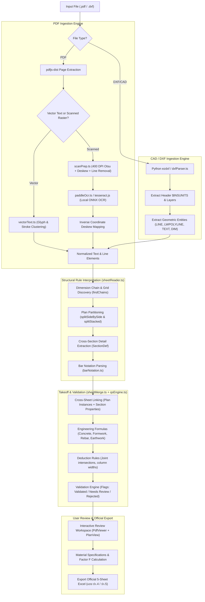

# StructBOQ — Processing Pipeline Specification

**Version:** 1.0  
**Date:** 2026-10-21  
**System Flow:** Deterministic Drawing Ingestion to Auditable BOQ Export  

---

## 1. High-Level Architectural Pipeline

---

## 2. Detailed Pipeline Stages

### Stage 1: Ingestion & Spatial Preprocessing
- **PDF Vector Extraction:**
  - Font glyphs and vector path operations are extracted via `pdfjs-dist`.
  - Letters drawn as CAD polylines/strokes are grouped into text bounding boxes using horizontal proximity ($d_x < 1.2h$) and baseline alignment ($|d_y| < 0.2h$).
- **Scanned Raster Preprocessing:**
  - Embedded images or rendered pages are processed at 400 DPI.
  - Adaptive Otsu binarization separates text strokes from paper background.
  - Skew angle ($\theta$) is estimated via Radon / projection variance across $[-3^\circ, +3^\circ]$.
  - Solid grid and dimension lines longer than 5 mm are subtracted to isolate text characters for OCR.
  - Local ONNX PaddleOCR v4 det/rec produces text tokens with confidence scores.
  - Bounding box coordinates are mapped back to the unskewed PDF page coordinates via inverse rotational transformation:
    $$\begin{bmatrix} x' \\ y' \end{bmatrix} = \begin{bmatrix} \cos\theta & -\sin\theta \cdot \frac{H}{W} \\ \sin\theta \cdot \frac{W}{H} & \cos\theta \end{bmatrix} \begin{bmatrix} x - 0.5 \\ y - 0.5 \end{bmatrix} + \begin{bmatrix} 0.5 \\ 0.5 \end{bmatrix}$$

### Stage 2: Structural Drafting Interpretation (`sheetReader.ts`)
- **Grid Axis & Bubble Alignment:**
  - Sequential numbers matching `DIM` regex ($\ge 0.50$ m) along common axes are grouped into dimension chains.
  - Circular bubbles containing grid letters ($A, B, C\dots$) or numbers ($1, 2, 3\dots$) at line terminals establish the project's spatial grid.
- **Scale Calibration (`sheetDen`):**
  - Evaluates ratio between dimension text values and pixel distances.
  - Validates against standard engineering scales ($1:25, 1:50, 1:75, 1:100, 1:200$). Never trusts unverified title block text blindly.
- **Plan Partitioning (`splitSideBySide` & `splitStacked`):**
  - Detects multi-plan drawings (e.g. shallow vs pile foundation on same sheet) by finding inter-plan gaps exceeding $1.5\times$ typical bay widths without dimension chains.

### Stage 3: Cross-Sheet Linking (`sheetMerge.ts`)
- Member instances found on framing plans (e.g. $B1$ spanning $A/1 \to A/2$, $L = 3.00$ m) are joined with section definitions extracted from schedule sheets or cross-section details.
- Matches take into account:
  - Exact tag match ($B1 = B1$).
  - Sequence order completion (associating unlabelled section slot preceding $B2$ as $B1$).
  - Structural type constraint (Footing $F$, Column $C$, Beam $B$, Slab $S$).

### Stage 4: Verified Mathematical Calculation (`qsEngine.ts`)
- **Concrete Volumes:**
  - Footings: $V = W \times L \times T$
  - Columns: $V = W \times D \times H - V_{\text{joint}}$
  - Beams: $V = W \times D \times L_{\text{net}}$
- **Formwork Contact Area:**
  - Calculated strictly on contact surfaces (excluding column/beam junctions and footing tops).
- **Reinforcement Steel Weight:**
  - Bar cut lengths incorporate anchorage hooks ($90^\circ$ and $180^\circ$ per วสท. standards).
  - Multiplied by exact TIS unit weights ($w_{\text{unit}} = 0.006165 \times d^2$).
- **Earthwork:**
  - Neat excavation volume $= (W + 2c)(L + 2c) \times H_{\text{depth}}$ where $c = 0.10$ m.

### Stage 5: Validation, Review & Por Ror 4/5 Export
- Each item is assigned an auditable status:
  - `VALIDATED`: All dimensions, rebars, and spans verified directly from drawing.
  - `NEEDS_REVIEW`: One or more properties defaulted, assumed, or showing conflict.
  - `REJECTED`: Rejected by reviewer or failing geometric plausibility.
- Export generates standard Thai Comptroller General Excel workbooks:
  1. แบบ ปร.4 (แยก 6 หมวดงานวิศวกรรมโครงสร้าง)
  2. แบบ ปร.5 (คำนวณ Factor F ค่าภาษี เงินล่วงหน้าจ่าย ดอกเบี้ยเงินกู้)
  3. ตารางสรุปปริมาณวัสดุและค่าแรง
  4. ตารางประวัติการตรวจสอบย้อนกลับ (Traceability Audit Trail)
