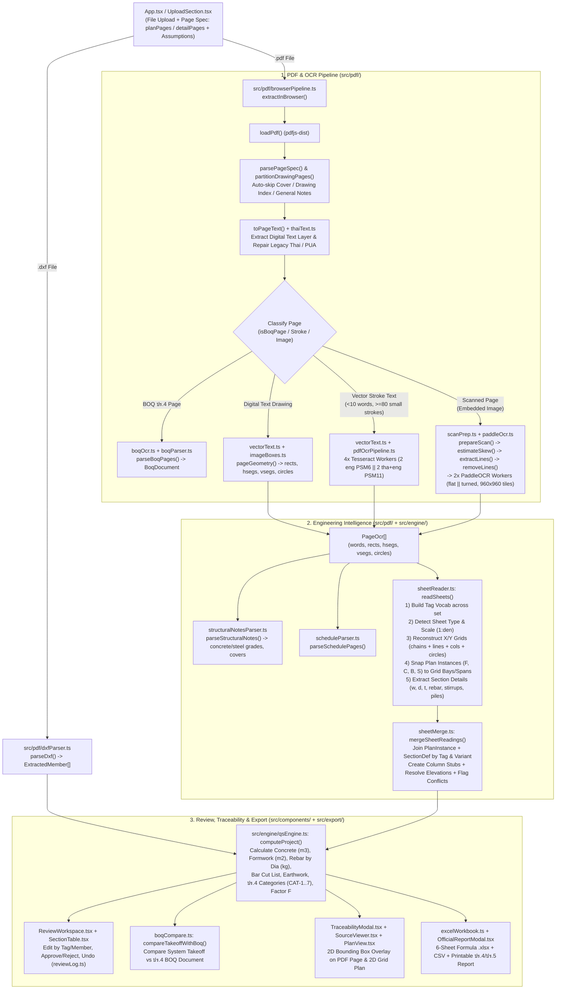

# StructBOQ — Comprehensive System Audit, Feature Gap Analysis & WebGPU Hardening Benchmark

**วันที่ตรวจสอบ:** 2 พฤศจิกายน 2026  
**ผู้ตรวจสอบ:** Antigravity (Autonomous Architecture & Performance Audit)  
**ขอบเขตการตรวจสอบ:** ตรวจสอบจากหลักฐานจริงใน Source Code (`src/**`, `tools/**`), Unit Tests (`10` ชุดทดสอบ), ผล Benchmark บนฮาร์ดแวร์จริง (**NVIDIA GeForce RTX 4050 Laptop GPU — 6,141 MiB VRAM**), และข้อมูลเฉลย (`real_drawings/*/answer_key.json` & `benchmark_offline.json`) โดย **ไม่แก้ไข Production Code ใน `src/` แม้แต่บรรทัดเดียว**

---

## A. Executive Summary

### 1. ภาพรวมความสามารถของระบบปัจจุบัน (Current System Capabilities)
**StructBOQ** เป็นระบบถอดปริมาณงานโครงสร้างและสร้างบัญชีแสดงปริมาณวัสดุ/ราคา (**BOQ / ปร.4**) แบบ **100% In-Browser Client-Side** (ไม่ต้องพึ่งพา Cloud API หรือ LLM ภายนอกในการอ่านแบบหลัก) ที่มีจุดเด่นเชิงวิศวกรรมสูงมากใน 4 ด้าน:
1. **การอ่านแบบหลายรูปแบบในเบราว์เซอร์เดียว:** รองรับทั้งไฟล์ดิจิทัล PDF (ดึง Text Layer + Vector Paths), ไฟล์ PDF ที่แปลงตัวอักษรเป็นเส้น Vector (`vectorText.ts` แยกเส้นสั้น `< 15 pt` ส่งเข้า Tesseract 4 Workers ขนาน), ไฟล์ PDF สแกน (`scanPrep.ts` เตรียมภาพ 400 DPI + ลบเส้นตาราง + ส่งเข้า PaddleOCR PP-OCRv4 ONNX), และไฟล์ CAD `.dxf` (`dxfParser.ts`)
2. **ความเข้าใจเชิงเรขาคณิตและวิศวกรรมโครงสร้าง (`sheetReader.ts` + `sheetMerge.ts`):** ไม่ได้ทำแค่ OCR ตัวอักษร แต่คำนวณพิกัดเส้นกริด (`A/1`, `A/1–A/2`) จากสายโซ่ตัวเลขบอกระยะ (`findChains`), เส้นกริด (`gridFromLines`), กรอบเสา (`gridFromColumns`), และวงกลมหัวกริด (`findRings`) พร้อมตรวจสอบมาตราส่วนจริง (`1:50`, `1:20`, `1:75`, `1:100`) และเชื่อมโยงชิ้นส่วนในแปลน (`PlanInstance`) เข้ากับหน้าตัดขยาย (`SectionDef`) ข้ามแผ่นอัตโนมัติ
3. **ความโปร่งใสและตรวจสอบย้อนกลับได้ระดับมืออาชีพ (`Traceability` & `Human-in-the-Loop Review`):** ทุกตัวเลขใน BOQ ผูกกับ `MemberProvenance` (`drawn`, `measured`, `inferred`, `assumed`, `missing`, `reviewer`) พร้อมกรอบพิกัด `box_2d` บนหน้า PDF จริง (`SourceViewer.tsx`, `TraceabilityModal.tsx`), มีระบบแก้ไของค์อาคารรายเบอร์ (`SectionTable.tsx` แก้ที่เดียวอัปเดตทุกต้น/คานที่ใช้เบอร์เดียวกัน), ระบบตรวจสอบความครบถ้วน (`CompletenessWarning`), และบันทึกประวัติการแก้ไข (`reviewLog.ts`)
4. **การคำนวณราคาและเปรียบเทียบ ปร.4 (`qsEngine.ts` + `boqCompare.ts` + `excelWorkbook.ts`):** คำนวณปริมาณคอนกรีต ไม้แบบ เหล็กเสริม (แยกขนาด RB6–DB25 พร้อมระยะทาบ/งอขอ/ลวดผูกเหล็ก 2.5%) งานดินขุด/ทราย/คอนกรีตหยาบ แยกตามหมวดหมู่ ปร.4 ของทางราชการ พร้อม Factor F และส่งออกเป็น Excel `.xlsx` 6 แผ่นงานที่มีสูตรผูกกันจริง (`SUM`, `B*E`)

### 2. ข้อสรุปผล WebGPU Hardening & Width Bucketing Benchmark
จากการทดสอบเชิงลึกบน **NVIDIA GeForce RTX 4050 Laptop GPU (VRAM 6,141 MiB)**:
- **ประสิทธิภาพความเร็ว (Speedup):** WebGPU (1 Worker Sequential: `flat -> turned` บน Session เดียว) เร็วกว่า WASM (2 Workers Parallel: `flat || turned`) **2.32× ถึง 2.86× สำหรับเวลา OCR** (เฉลี่ย **2.49×**) และลดเวลาประมวลผลรวมต่อหน้าลงเหลือ **7.50s – 21.48s** (เร็วขึ้น **1.91× – 2.26×**)
- **ความแม่นยำ (OCR Parity — Dynamic Width `bucket=0`):** ให้ผลลัพธ์ตรงกับ WASM **100.00% ทุกตัวอักษรและทุกพิกัดกรอบคำ (`maxCoordDiff = 0`)** บนทั้ง 5 หน้าทดสอบ (`cdc_1` น.18, น.22, `toilet_604_45` น.2, `house_ready_3` น.25, น.34)
- **ผลการทดลอง Width Bucketing (`Bucket 64`, `Bucket 128`, `Bucket 256`):**
  - การจัดกลุ่มความกว้างเป็น `64`, `128`, `256` px ช่วยลดจำนวน Unique Shapes (`[1, 3, 48, W]`) จาก **94–166 รูปทรง/หน้า** เหลือเพียง **10–14 รูปทรง (`Bucket 64`)**, **6–8 รูปทรง (`Bucket 128`)**, และ **3–5 รูปทรง (`Bucket 256`)**
  - **แต่พบข้อเท็จจริงเชิงวิศวกรรมที่สำคัญมาก (Critical Discovery):** โมเดล `ch_PP-OCRv4_rec_infer.onnx` ใช้สถาปัตยกรรม SVTR/LCNet ที่มีชั้น **Global Average Pooling / Adaptive Pooling ตามแนวกว้าง** ก่อนเข้าหัวอ่าน CTC เมื่อเติมขอบขาว (`White Padding = 255`) ด้านขวาเพื่อให้ครบ Bucket (`W_bucket > W0`) พื้นที่สีขาวที่เพิ่มเข้ามาจะเปลี่ยนค่าสถิติ Feature Map และเปลี่ยนการรับรู้จุดจบของคำ ทำให้ **ความแม่นยำข้อความ (Exact Text Parity) ตกลงอย่างรุนแรง**:
    - `Dynamic (bucket=0)`: **100.00%** parity
    - `Bucket 64`: ตกลงเหลือ **63.51% – 74.55%** (จำนวนคำที่อ่านได้หายไป 9%–31%)
    - `Bucket 128`: ตกลงเหลือ **27.03% – 72.92%** (จำนวนคำที่อ่านได้หายไป 22%–65%)
    - `Bucket 256`: ตกลงเหลือ **16.00% – 76.74%** (จำนวนคำที่อ่านได้หายไป 38%–76%)
  - **สาเหตุที่แท้จริงของ VRAM Spike (`5,743 MiB`) และวิธีแก้ที่ไม่เสียความแม่นยำ:** จากการวัดผลแยกขั้นตอน พบว่าการพุ่งของ VRAM ไปที่ `5,490–5,743 MiB` ในรอบก่อน **ไม่ได้เกิดจาก `Dynamic Width` ของ WebGPU** แต่เกิดจากการเปิด **WASM 2 Workers ควบคู่กับ WebGPU Worker พร้อมกันในหน้าเพจเดียวกันขณะเตรียมภาพ PDF ขนาดใหญ่ (`6619×4680`)** เมื่อรัน **WebGPU `Dynamic (bucket=0)` เพียงอย่างเดียว** พร้อมเรียก `.dispose()` ทุก Tensor:
    - VRAM บนหน้า `toilet_604_45` น.2 ใช้เพียง **1,614 – 1,705 MiB** (ต่ำกว่าเพดาน 6 GB ถึง 4.4 GB!)
    - การรันต่อเนื่อง **46 หน้าติดต่อกัน (`1 หน้า -> 5 หน้า -> 10 หน้า -> 30 หน้า`)** ด้วย `Dynamic (bucket=0)` สำเร็จครบ **100% โดยไม่เกิด OOM, ไม่เกิด Device Lost, และไม่ตกไปใช้ WASM เลย** โดยใช้ VRAM ทรงตัวอยู่ในช่วง **2,787 – 5,291 MiB** และเมื่อจบชุด 30 หน้า VRAM ลดลงมาอยู่ที่ **2,787 MiB** (ไม่มี Memory Leak สะสม)

### 3. ข้อสรุปความพร้อมใช้งานจริง (Commercial & Production Readiness Verdict)
- **สถานะปัจจุบัน:** **`Pilot-Ready with Human-in-the-Loop QS Review`** (พร้อมใช้งานจริงในฐานะระบบผู้ช่วยวิศวกรถอดแบบ/ประมาณราคาที่มีคนตรวจทานตารางหน้าตัดก่อนออกรายงาน แต่ **ยังไม่พร้อมแบบ Fully Autonomous 100% Zero-Review** สำหรับแบบสแกน)
- **จุดคอขวดสำคัญ 3 อันดับแรกที่ต้องแก้ก่อนใช้งานเชิงพาณิชย์เต็มรูปแบบ:**
  1. **[P0 — Accuracy & BOQ Bug]** สูตรคำนวณเหล็กเสริมพื้นหล่อในที่ (`SLAB`) ใน [`src/engine/qsEngine.ts`](file:///C:/Users/supak/Desktop/structboq-ai-construction-quantity-surveying-oct-16-2026-5-13-56-pm/src/engine/qsEngine.ts#L535-L537) ใช้ความยาวเหล็กตายตัว `cutLen = 1.10 m` ทำให้ตารางตัดเหล็ก (`barList`) แสดงความยาวท่อนเหล็กพื้นผิดเป็น `1.10 ม.` ทุกเส้น และเสาเข็ม (`pilesNos`) คำนวณจำนวนต้นได้แต่ยังไม่ได้คูณราคาค่าวัสดุ/ค่าตอกเข้าใน `totalCostThb`
  2. **[P0 — Memory & Worker Lifecycle]** โค้ดใช้งานจริงใน [`src/pdf/paddleOcr.ts`](file:///C:/Users/supak/Desktop/structboq-ai-construction-quantity-surveying-oct-16-2026-5-13-56-pm/src/pdf/paddleOcr.ts#L39-L90) ยังไม่เรียก `.dispose()` บน ORT Tensor และ [`src/pdf/browserPipeline.ts`](file:///C:/Users/supak/Desktop/structboq-ai-construction-quantity-surveying-oct-16-2026-5-13-56-pm/src/pdf/browserPipeline.ts#L385-L580) ไม่เคยสั่ง `.terminate()` ปิด PaddleOCR Workers (2 ตัว) และ Tesseract Workers (5 ตัว) หลังอ่านแบบเสร็จ ทำให้กิน RAM ค้าง ~1.7–1.8 GB
  3. **[P1 — Speed & Scan Resolution]** โค้ดใช้งานจริงใน [`src/pdf/browserPipeline.ts`](file:///C:/Users/supak/Desktop/structboq-ai-construction-quantity-surveying-oct-16-2026-5-13-56-pm/src/pdf/browserPipeline.ts#L365-L370) ยังเรนเดอร์หน้าสแกนที่ `scale = 2` (144 DPI) บน WASM ทำให้อ่านตัวอักษรขนาดเล็กในแบบขยายสแกน (`cdc_1`, `toilet_604_45`) ตกหล่น ต้องนำ **400-DPI Embedded Scan Prep + WebGPU 1-Worker (`bucket=0`) + Tensor `.dispose()` + WASM Fallback** เข้าสู่ระบบหลัก

---

## B. System Architecture Map

### 1. แผนผังการไหลของข้อมูลตั้งแต่ต้นจนจบ (End-to-End Pipeline Diagram)

### 2. การตรวจสอบเชิงลึกตามหมวดสถาปัตยกรรม (Part 1 Detailed Audit)

#### 1.1 การรับและประมวลผลไฟล์ (File Ingestion & Page Selection)
- **การแยกประเภทไฟล์:** [`src/App.tsx`](file:///C:/Users/supak/Desktop/structboq-ai-construction-quantity-surveying-oct-16-2026-5-13-56-pm/src/App.tsx#L140-L240) แยกไฟล์ `.dxf` ส่งเข้า [`parseDxf()`](file:///C:/Users/supak/Desktop/structboq-ai-construction-quantity-surveying-oct-16-2026-5-13-56-pm/src/pdf/dxfParser.ts#L164-L447) และส่งไฟล์ `.pdf` เข้า [`extractInBrowser()`](file:///C:/Users/supak/Desktop/structboq-ai-construction-quantity-surveying-oct-16-2026-5-13-56-pm/src/pdf/browserPipeline.ts#L380-L622) (ส่วนไฟล์ `.dwg` ไบนารียังไม่รองรับโดยตรง ต้องแปลงเป็น `.dxf` หรือ `.pdf` ก่อน)
- **การแยกประเภทหน้า PDF:** [`browserPipeline.ts`](file:///C:/Users/supak/Desktop/structboq-ai-construction-quantity-surveying-oct-16-2026-5-13-56-pm/src/pdf/browserPipeline.ts#L415-L490) และ [`pdfOcrPipeline.ts`](file:///C:/Users/supak/Desktop/structboq-ai-construction-quantity-surveying-oct-16-2026-5-13-56-pm/src/pdf/pdfOcrPipeline.ts#L130-L290) แยกหน้าเป็น 4 กลุ่มอัตโนมัติ:
  1. **หน้ามี Text Layer ดิจิทัล:** ดึงพิกัดคำด้วย [`toPageText()`](file:///C:/Users/supak/Desktop/structboq-ai-construction-quantity-surveying-oct-16-2026-5-13-56-pm/src/pdf/pdfText.ts#L1-L95) + ซ่อมฟอนต์ไทยรุ่นเก่า/PUA ด้วย [`thaiText.ts`](file:///C:/Users/supak/Desktop/structboq-ai-construction-quantity-surveying-oct-16-2026-5-13-56-pm/src/pdf/thaiText.ts)
  2. **หน้า Vector Stroke Lettering (แปลงฟอนต์เป็นเส้น):** เมื่อคำดิจิทัล `< 10` คำ แต่มีเส้นสั้น (`< 15 pt`) ตั้งแต่ `80` เส้นขึ้นไป ระบบจะแปลงเฉพาะเส้นตัวอักษรเป็นภาพขาวดำด้วย [`rasterize()`](file:///C:/Users/supak/Desktop/structboq-ai-construction-quantity-surveying-oct-16-2026-5-13-56-pm/src/pdf/vectorText.ts#L120-L165) แล้วส่งเข้า Tesseract 4 Workers ขนานกัน
  3. **หน้าสแกน (Scanned Raster):** เมื่อมี `paintImageXObject` และคำดิจิทัล `< 10` คำ จะเข้าสู่ [`prepareScan()`](file:///C:/Users/supak/Desktop/structboq-ai-construction-quantity-surveying-oct-16-2026-5-13-56-pm/src/pdf/scanPrep.ts) และ [`paddleOcr.ts`](file:///C:/Users/supak/Desktop/structboq-ai-construction-quantity-surveying-oct-16-2026-5-13-56-pm/src/pdf/paddleOcr.ts)
  4. **หน้า Hybrid (Vector + Raster):** ดึงทั้งกรอบสี่เหลี่ยม/เส้นจาก Vector (`pageGeometry`) และกรอบภาพ (`imageBoxesOnPage`) มารวมกันใน `PageOcr`
- **การคัดกรองหน้าและการเลือกหน้าโดยผู้ใช้ (`parsePageSpec` & `partitionDrawingPages`):**
  - [`parsePageSpec()`](file:///C:/Users/supak/Desktop/structboq-ai-construction-quantity-surveying-oct-16-2026-5-13-56-pm/src/pdf/pdfOcrPipeline.ts#L16-L79) จัดการเลขหน้าเดี่ยว, ช่วงหน้า (`18-22`), ช่วงย้อนกลับ (`22-18` พร้อมแจ้งเตือน), เลขหน้าติดลบ/ผิดรูปแบบ, และเลขหน้าเกินจำนวนหน้าจริง (`> numPages`) ได้อย่างรัดกุม
  - [`partitionDrawingPages()`](file:///C:/Users/supak/Desktop/structboq-ai-construction-quantity-surveying-oct-16-2026-5-13-56-pm/src/pdf/pdfOcrPipeline.ts#L85-L128) แยก `planPages` กับ `detailPages` ออกจากกันและตัดเลขหน้าที่ซ้ำออกโดยอัตโนมัติ
  - เมื่อผู้ใช้ไม่ระบุเลขหน้า ระบบจะสแกนหาเฉพาะหน้าโครงสร้าง (`S-`, `ST-`, แปลนฐานราก/เสา/คาน/พื้น) และข้ามหน้าสารบัญแบบ (`isDrawingIndexSheet`) หรือหน้ารายการประกอบแบบ (`general_notes`) เพื่อป้องกันการอ่านชื่อเบอร์คาน/ฐานรากในตารางสารบัญมาเป็นชิ้นส่วนหลอก (Phantom Members)

#### 1.2 ระบบ OCR (`src/pdf/paddleOcr.ts`, `scanPrep.ts`, `vectorText.ts`)
- **PaddleOCR Pipeline:** ใช้โมเดล `ch_PP-OCRv4_det_infer.onnx` (DBNet สำหรับหากรอบข้อความ) และ `ch_PP-OCRv4_rec_infer.onnx` (SVTR-LCNet CTC สำหรับอ่านข้อความ 6,625 ตัวอักษร) บน `onnxruntime-web@1.30.0`
- **การเตรียมภาพ (`scanPrep.ts`):** ปรับ Contrast แบบ Percentile (`prepareScan`), วัดมุมเอียงด้วย Radon/Projection Profile (`estimateSkew`) แล้วหมุนภาพให้ตรง (`rotateRaster`), สกัดเส้นตรงแนวนอน/แนวตั้ง (`extractLines`) และวงกลมหัวกริด (`findRings`, `ringsAtLineEnds`), จากนั้นลบเส้นตารางยาว (`removeLines`) ออกก่อนส่งเข้า OCR เพื่อไม่ให้เส้นตารางทับตัวอักษร
- **การแบ่ง Tile และการรวมคำ:** แบ่งภาพเป็น Tile ขนาด `960×960 px` ซ้อนทับ `96 px` (`step = 864 px`), รันทั้งแนวนอน (`flat`) และแนวตั้งหมุน 90° (`turned` โดยกรองเฉพาะกล่องแนวนอนในภาพที่หมุนแล้ว `flatOnly = true`), แปลงพิกัดกลับเป็นสัดส่วน `0..1` ของหน้ากระดาษ แล้วตัดคำซ้ำด้วย [`dedupeWords()`](file:///C:/Users/supak/Desktop/structboq-ai-construction-quantity-surveying-oct-16-2026-5-13-56-pm/src/pdf/ocr.ts#L28-L55) (IoU > 0.35 เก็บตัวที่ `conf` สูงกว่า และใช้ Deterministic Tie-break)

---

## C. Feature Gap Matrix (StructBOQ vs Commercial AI Takeoff Systems)

ตารางด้านล่างประเมินความสามารถทุกหมวดตามเกณฑ์มาตรฐานเทียบกับซอฟต์แวร์ถอดแบบเชิงพาณิชย์ (เช่น PlanSwift / Bluebeam / Kreo / Togal.AI / Cubicost) โดยอ้างอิงไฟล์และบรรทัดโค้ดจริง:

| หมวดหมู่ | ฟีเจอร์ย่อย | สถานะ | หลักฐานในโค้ด (File & Line Reference) | รายละเอียดสิ่งที่ทำได้จริง vs ช่องว่างที่ยังขาด (Gap) |
| :--- | :--- | :---: | :--- | :--- |
| **2.1 Drawing Intelligence** | การแยกประเภทหน้าแบบ (Sheet Classification) | `Implemented` | [`sheetReader.ts`](file:///C:/Users/supak/Desktop/structboq-ai-construction-quantity-surveying-oct-16-2026-5-13-56-pm/src/pdf/sheetReader.ts#L334-L398) | แยก `footing_plan`, `framing_plan`, `roof_plan`, `column_schedule`, `section_detail`, `building_section`, `general_notes`, `drawing_index`, `other` ได้แม่นยำ |
| | การอ่าน Title Block & Sheet ID | `Implemented` | [`sheetReader.ts`](file:///C:/Users/supak/Desktop/structboq-ai-construction-quantity-surveying-oct-16-2026-5-13-56-pm/src/pdf/sheetReader.ts#L315-L348) | อ่านรหัสแผ่น `S-01`..`S-99`, `ST-01`, ชื่อแผ่นงาน และแยกทางเลือกฐานราก (`แผ่` vs `เสาเข็ม`) จากหัวกระดาษ |
| | การตรวจจับมาตราส่วน (Scale Detection) | `Implemented` | [`sheetReader.ts`](file:///C:/Users/supak/Desktop/structboq-ai-construction-quantity-surveying-oct-16-2026-5-13-56-pm/src/pdf/sheetReader.ts#L100-L115), [`L440-L470`](file:///C:/Users/supak/Desktop/structboq-ai-construction-quantity-surveying-oct-16-2026-5-13-56-pm/src/pdf/sheetReader.ts#L440-L470) | อ่านตัวเลข `1:xx` และ **คำนวณทวนกลับจากระยะพิกัดตัวเลขบอกระยะจริงบนกระดาษ (`sheetDen`)** เพื่อแก้กรณีเขียนมาตราส่วนผิดหรือสแกนย่อ/ขยาย |
| | การตรวจจับ Grid Lines & Grid Bubbles | `Implemented` | [`sheetReader.ts`](file:///C:/Users/supak/Desktop/structboq-ai-construction-quantity-surveying-oct-16-2026-5-13-56-pm/src/pdf/sheetReader.ts#L156-L312), [`L480-L960`](file:///C:/Users/supak/Desktop/structboq-ai-construction-quantity-surveying-oct-16-2026-5-13-56-pm/src/pdf/sheetReader.ts#L480-L960) | ผสาน 4 แหล่งข้อมูล: สายโซ่ตัวเลขบอกระยะ (`findChains`), เส้นกริด (`gridFromLines`), กรอบเสา (`gridFromColumns`), และวงกลมชื่อกริด (`findRings` A, B, C / 1, 2, 3) |
| | การอ่านตัวเลขบอกระยะ (Dimension Reading) | `Implemented` | [`sheetReader.ts`](file:///C:/Users/supak/Desktop/structboq-ai-construction-quantity-surveying-oct-16-2026-5-13-56-pm/src/pdf/sheetReader.ts#L156-L245), [`L1300-L1520`](file:///C:/Users/supak/Desktop/structboq-ai-construction-quantity-surveying-oct-16-2026-5-13-56-pm/src/pdf/sheetReader.ts#L1300-L1520) | อ่านทั้งระยะช่วงกริดในแปลน และขนาด กว้าง×ลึก/หนา ในหน้าตัดขยาย พร้อมซ่อมคำผิดจาก OCR (เช่น `,` เป็น `.` หรือ `O` เป็น `0`) |
| | การอ่านสัญลักษณ์และหมายเหตุประกอบแบบ | `Implemented` | [`structuralNotesParser.ts`](file:///C:/Users/supak/Desktop/structboq-ai-construction-quantity-surveying-oct-16-2026-5-13-56-pm/src/pdf/structuralNotesParser.ts#L1-L274) | อ่านกำลังอัดคอนกรีต `fc'`, ชั้นคุณภาพเหล็ก `SR24/SD40/SD50`, ระยะหุ้มคอนกรีต (`cover`), และชนิดปูนซีเมนต์ |
| | การแยกแยะองค์อาคารโครงสร้าง vs สถาปัตย์ | `Partial` | [`sheetReader.ts`](file:///C:/Users/supak/Desktop/structboq-ai-construction-quantity-surveying-oct-16-2026-5-13-56-pm/src/pdf/sheetReader.ts#L67-L95) | แยกองค์อาคารโครงสร้าง ค.ส.ล. (`F`, `C`, `B`, `GB`, `RB`, `S`, `GS`, `ST`) และข้ามโครงเหล็ก (`BS1`, `T1`) ได้ดี แต่ยังไม่สกัดผนัง/ประตู/หน้าต่างจากภาพแปลนสถาปัตย์ |
| **2.2 Visual Takeoff** | การวัดความยาว (Linear Measurement) | `Partial` | [`sheetReader.ts`](file:///C:/Users/supak/Desktop/structboq-ai-construction-quantity-surveying-oct-16-2026-5-13-56-pm/src/pdf/sheetReader.ts#L1180-L1290), [`dxfParser.ts`](file:///C:/Users/supak/Desktop/structboq-ai-construction-quantity-surveying-oct-16-2026-5-13-56-pm/src/pdf/dxfParser.ts#L310-L390) | คำนวณความยาวคานอัตโนมัติจากระยะกริด (`from_grid -> to_grid`) หรือจากเส้น DXF แต่ **ยังไม่มีเครื่องมือให้ผู้ใช้คลิกลากวัดระยะ (Interactive Ruler/Polyline) บนหน้า PDF โดยตรง** |
| | การวัดพื้นที่ (Area Measurement) | `Partial` | [`sheetMerge.ts`](file:///C:/Users/supak/Desktop/structboq-ai-construction-quantity-surveying-oct-16-2026-5-13-56-pm/src/engine/sheetMerge.ts#L420-L465) | คำนวณพื้นที่แผ่นพื้น (`SLAB`) จากช่องกริด (`bay`) อัตโนมัติ แต่ยังไม่มีเครื่องมือวาด Polygon วัดพื้นที่อิสระบนหน้า PDF |
| | การนับจำนวนชิ้นส่วน (Count Detection) | `Implemented` | [`sheetReader.ts`](file:///C:/Users/supak/Desktop/structboq-ai-construction-quantity-surveying-oct-16-2026-5-13-56-pm/src/pdf/sheetReader.ts#L1050-L1295) | นับจำนวนฐานราก เสา คาน พื้น รายตำแหน่งกริด พร้อมตัดรายการซ้ำภายในรัศมีเดียวกัน |
| | การคำนวณปริมาตร (Volume Calculation) | `Implemented` | [`qsEngine.ts`](file:///C:/Users/supak/Desktop/structboq-ai-construction-quantity-surveying-oct-16-2026-5-13-56-pm/src/engine/qsEngine.ts#L360-L640) | คำนวณปริมาตรสุทธิ (`volumeNetM3`) และปริมาตรเผื่อสูญเสีย (`volumeGrossM3`) แยกตามชนิดโครงสร้าง |
| | การหักลดจุดตัด/ช่วงซ้อนทับ (Opening / Overlap Deduction) | `Implemented` | [`sheetMerge.ts`](file:///C:/Users/supak/Desktop/structboq-ai-construction-quantity-surveying-oct-16-2026-5-13-56-pm/src/engine/sheetMerge.ts#L415-L420), [`qsEngine.ts`](file:///C:/Users/supak/Desktop/structboq-ai-construction-quantity-surveying-oct-16-2026-5-13-56-pm/src/engine/qsEngine.ts#L365-L378) | หักความกว้างเสารองรับ (`supportColW1`, `supportColW2`) ออกจากความยาวคานช่วงสุทธิ (`isClearSpan`) และตรวจจับแผ่นพื้นซ้อนทับในช่องกริดเดียวกัน (`SLAB_OVERLAP`) |
| **2.3 Structural Quantity** | เสาเข็ม (Piles) | `Partial` | [`sheetReader.ts`](file:///C:/Users/supak/Desktop/structboq-ai-construction-quantity-surveying-oct-16-2026-5-13-56-pm/src/pdf/sheetReader.ts#L1515-L1535), [`qsEngine.ts`](file:///C:/Users/supak/Desktop/structboq-ai-construction-quantity-surveying-oct-16-2026-5-13-56-pm/src/engine/qsEngine.ts#L406-L412) | อ่านขนาดเสาเข็ม (`0.15x0.15x6.00`) และจำนวนต้นต่อฐานราก (`pilesNos`) ได้จริง **แต่ใน `qsEngine.ts` ยังไม่ได้คิดราคาค่าเสาเข็มและค่าตอกรวมเข้าใน `totalCostThb`** |
| | ฐานราก (Footings) + ดินขุด/ทราย/คอนกรีตหยาบ | `Implemented` | [`sheetReader.ts`](file:///C:/Users/supak/Desktop/structboq-ai-construction-quantity-surveying-oct-16-2026-5-13-56-pm/src/pdf/sheetReader.ts#L125-L154), [`qsEngine.ts`](file:///C:/Users/supak/Desktop/structboq-ai-construction-quantity-surveying-oct-16-2026-5-13-56-pm/src/engine/qsEngine.ts#L380-L435) | อ่านทั้งจากตัวเลขและวัดจากเส้นหน้าตัดฐานราก (`footingSections`), แยกงานดินขุด (เผื่อลาดเอียง `0.30 ม.`), ทรายรองพื้น `0.05 ม.`, คอนกรีตหยาบ `0.05 ม.` เข้าหมวด 1 |
| | เสาตอม่อและเสาโครงสร้าง (Columns) | `Implemented` | [`sheetMerge.ts`](file:///C:/Users/supak/Desktop/structboq-ai-construction-quantity-surveying-oct-16-2026-5-13-56-pm/src/engine/sheetMerge.ts#L280-L390), [`qsEngine.ts`](file:///C:/Users/supak/Desktop/structboq-ai-construction-quantity-surveying-oct-16-2026-5-13-56-pm/src/engine/qsEngine.ts#L455-L490) | สร้างเสาตอม่ออัตโนมัติจากป้ายคู่ `'F1, C1'`, คำนวณความสูงจากค่าระดับในรูปตัดอาคาร (`levels`), คำนวณเหล็กยืน (`+40d` ทาบ) และเหล็กปลอก |
| | คานคอดิน คานชั้นบน คานหลังคา (GB, B, RB) | `Implemented` | [`sheetReader.ts`](file:///C:/Users/supak/Desktop/structboq-ai-construction-quantity-surveying-oct-16-2026-5-13-56-pm/src/pdf/sheetReader.ts#L1300-L1510), [`qsEngine.ts`](file:///C:/Users/supak/Desktop/structboq-ai-construction-quantity-surveying-oct-16-2026-5-13-56-pm/src/engine/qsEngine.ts#L491-L525) | รองรับเหล็กเสริม 2 ชั้น (`3-RB12+2-DB16`), คานยื่น/คานซอยภายในช่องกริด, หน้าตัดชื่อรูปตัด (`2–2`, `G1–G1`), หักหน้าเสา, คำนวณไม้แบบ 3 ด้าน |
| | พื้นหล่อในที่และพื้นสำเร็จรูป (Slabs: S, GS, SP) | `Partial` | [`sheetMerge.ts`](file:///C:/Users/supak/Desktop/structboq-ai-construction-quantity-surveying-oct-16-2026-5-13-56-pm/src/engine/sheetMerge.ts#L420-L465), [`qsEngine.ts`](file:///C:/Users/supak/Desktop/structboq-ai-construction-quantity-surveying-oct-16-2026-5-13-56-pm/src/engine/qsEngine.ts#L430-L450), [`L526-L558`](file:///C:/Users/supak/Desktop/structboq-ai-construction-quantity-surveying-oct-16-2026-5-13-56-pm/src/engine/qsEngine.ts#L526-L558) | แยกพื้นวางบนดิน (`GS` คิดทรายอัดแน่น), พื้นสำเร็จรูป (`SP` คิดแผ่นสำเร็จรูป + Topping + Wire Mesh), และพื้นหล่อในที่ **แต่มีบั๊กสูตรความยาวท่อนเหล็กพื้นหล่อในที่ `cutLen = 1.10 m` ใน `qsEngine.ts` บรรทัด 536** |
| | บันได (Staircase: ST) | `Partial` | [`sheetReader.ts`](file:///C:/Users/supak/Desktop/structboq-ai-construction-quantity-surveying-oct-16-2026-5-13-56-pm/src/pdf/sheetReader.ts#L1470), [`sheetMerge.ts`](file:///C:/Users/supak/Desktop/structboq-ai-construction-quantity-surveying-oct-16-2026-5-13-56-pm/src/engine/sheetMerge.ts#L467-L490) | มีสูตรคำนวณความยาวลาดเอียง $\sqrt{\text{run}^2 + \text{rise}^2}$ และเหล็กบันไดใน `qsEngine.ts` แต่ `sheetReader.ts` อ่านเฉพาะความหนาพื้นบันได ยังไม่ได้สกัดระยะแนวราบ (`แนวราบ`) จากแบบอัตโนมัติ |
| | ผนัง ประตู หน้าต่าง งานสถาปัตย์ | `Prototype` | [`qsEngine.ts`](file:///C:/Users/supak/Desktop/structboq-ai-construction-quantity-surveying-oct-16-2026-5-13-56-pm/src/engine/qsEngine.ts#L580-L600), [`scheduleParser.ts`](file:///C:/Users/supak/Desktop/structboq-ai-construction-quantity-surveying-oct-16-2026-5-13-56-pm/src/pdf/scheduleParser.ts) | มีสูตรคำนวณใน `qsEngine.ts` (`CAT-7`) และอ่านจากตารางข้อความได้ แต่ `sheetReader.ts` ยังไม่สกัดผนัง/ประตู/หน้าต่างจากภาพแปลน |
| **2.4 Human Review** | การแก้ไขขนาด เหล็กเสริม จำนวน และการอนุมัติ/ปฏิเสธ | `Implemented` | [`ReviewWorkspace.tsx`](file:///C:/Users/supak/Desktop/structboq-ai-construction-quantity-surveying-oct-16-2026-5-13-56-pm/src/components/ReviewWorkspace.tsx#L1-L469), [`SectionTable.tsx`](file:///C:/Users/supak/Desktop/structboq-ai-construction-quantity-surveying-oct-16-2026-5-13-56-pm/src/components/SectionTable.tsx#L1-L237) | แก้ไขได้ทั้งรายชิ้น (`ReviewWorkspace`) และรายเบอร์หน้าตัด (`SectionTable`), กดยืนยัน (`approved`), ปฏิเสธ (`rejected`), ย้อนกลับ (`Undo`), และรับรายการแนะนำจาก Completeness Check |
| | การลากปรับกรอบ Bounding Box หรือคลิกเพิ่มชิ้นส่วนบนแปลน PDF | `Missing` | [`SourceViewer.tsx`](file:///C:/Users/supak/Desktop/structboq-ai-construction-quantity-surveying-oct-16-2026-5-13-56-pm/src/components/SourceViewer.tsx#L1-L86) | `SourceViewer` แสดงกรอบสีทับจุดที่อ่านบนหน้า PDF ได้อย่างเดียว ยังไม่รองรับการคลิกลากกรอบใหม่บนภาพ PDF |
| **2.5 Traceability** | การผูกตัวเลข BOQ กลับไปยังหน้าแบบ กรอบพิกัด และสูตรคำนวณ | `Implemented` | [`TraceabilityModal.tsx`](file:///C:/Users/supak/Desktop/structboq-ai-construction-quantity-surveying-oct-16-2026-5-13-56-pm/src/components/TraceabilityModal.tsx#L1-L172), [`ReadingLog.tsx`](file:///C:/Users/supak/Desktop/structboq-ai-construction-quantity-surveying-oct-16-2026-5-13-56-pm/src/components/ReadingLog.tsx#L1-L146) | แสดงครบถ้วนทั้งเลขหน้า, กรอบพิกัด `box_2d`, แหล่งที่มาของค่าแต่ละช่อง (`drawn`/`measured`/`inferred`/`assumed`), ข้อขัดแย้ง (`conflicts`), และขั้นตอนการคำนวณ (`calculationSteps`) |
| **2.6 BOQ Cost Engine** | ราคาวัสดุ ค่าแรง เผื่อสูญเสีย Factor F ภาษี และเกณฑ์กรมบัญชีกลาง | `Implemented` | [`qsEngine.ts`](file:///C:/Users/supak/Desktop/structboq-ai-construction-quantity-surveying-oct-16-2026-5-13-56-pm/src/engine/qsEngine.ts#L50-L240), [`MaterialSettingsModal.tsx`](file:///C:/Users/supak/Desktop/structboq-ai-construction-quantity-surveying-oct-16-2026-5-13-56-pm/src/components/MaterialSettingsModal.tsx) | ปรับตั้งค่าสเปกวัสดุ ราคาต่อหน่วย ค่าแรง เปอร์เซ็นต์เผื่อสูญเสีย และคำนวณตาราง Factor F ตามขั้นค่างานต้นทุนของทางราชการได้ครบ |
| **2.7 Revision Comparison** | การเปรียบเทียบแบบก่อสร้าง Revision A vs Revision B | `Missing` | [`boqCompare.ts`](file:///C:/Users/supak/Desktop/structboq-ai-construction-quantity-surveying-oct-16-2026-5-13-56-pm/src/engine/boqCompare.ts#L1-L154) | มีเฉพาะการเปรียบเทียบปริมาณที่ระบบถอดได้กับเอกสาร ปร.4 (`compareTakeoffWithBoq`) แต่ **ยังไม่มีฟีเจอร์เปรียบเทียบแบบ Drawing Rev A vs Rev B** |
| **2.8 Data Management** | การบันทึกสถานะงาน การตั้งค่า และการกู้คืน | `Partial` | [`reviewLog.ts`](file:///C:/Users/supak/Desktop/structboq-ai-construction-quantity-surveying-oct-16-2026-5-13-56-pm/src/engine/reviewLog.ts#L85-L128), [`App.tsx`](file:///C:/Users/supak/Desktop/structboq-ai-construction-quantity-surveying-oct-16-2026-5-13-56-pm/src/App.tsx#L95-L135) | บันทึกประวัติการแก้ไข (`structboq_review2::<fileName>`) และราคาวัสดุลง `localStorage` อัตโนมัติ แต่ไม่ได้บันทึก `extractedMembers` หรือไฟล์ PDF ลง IndexedDB (ต้องอัปโหลดไฟล์เดิมซ้ำเพื่อทาบผลการแก้ไข) |
| **2.9 Reporting & Export** | รายงาน Excel `.xlsx` ผูกสูตร, CSV, และรายงานราชการ ปร.4 / ปร.5 | `Implemented` | [`excelWorkbook.ts`](file:///C:/Users/supak/Desktop/structboq-ai-construction-quantity-surveying-oct-16-2026-5-13-56-pm/src/export/excelWorkbook.ts#L1-L260), [`OfficialReportModal.tsx`](file:///C:/Users/supak/Desktop/structboq-ai-construction-quantity-surveying-oct-16-2026-5-13-56-pm/src/components/OfficialReportModal.tsx#L1-L213) | ส่งออก `.xlsx` 6 แผ่นงาน (`ปร.5 สรุป`, `ปร.4 แยกหมวด`, `รายการคำนวณรายชิ้น`, `ตารางตัดเหล็ก`, `ร่องรอยการอ่าน`, `สมมติฐานและราคา`) พร้อมสูตร Excel จริง และพิมพ์ PDF ปร.4/ปร.5 ได้ทันที |
| **2.10 Production Readiness** | Error Handling, Timeout, Cancellation, Memory Cleanup | `Partial` | [`browserPipeline.ts`](file:///C:/Users/supak/Desktop/structboq-ai-construction-quantity-surveying-oct-16-2026-5-13-56-pm/src/pdf/browserPipeline.ts#L380-L622), [`paddleOcr.ts`](file:///C:/Users/supak/Desktop/structboq-ai-construction-quantity-surveying-oct-16-2026-5-13-56-pm/src/pdf/paddleOcr.ts#L39-L90) | จัดการ `doc.destroy()` ใน `finally` แล้ว แต่ **ยังไม่มีปุ่มยกเลิกงาน (Cancellation / AbortController)**, **ยังไม่เรียก `.dispose()` บน ORT Tensor ใน `src/pdf/paddleOcr.ts`**, และ **ยังไม่สั่ง `worker.terminate()` หลังจบงาน** |

---

## D. WebGPU Benchmark & Width Bucketing Results

### 1. สภาพแวดล้อมฮาร์ดแวร์และซอฟต์แวร์ที่ใช้ทดสอบ (Hardware & Runtime Environment)
- **GPU:** NVIDIA GeForce RTX 4050 Laptop GPU (Architecture: Ada Lovelace, Dedicated VRAM: **6,141 MiB**, Driver Max Buffer: **2,147,483,648 bytes**)
- **CPU / OS:** Windows 11, 16 Logical Cores (`navigator.hardwareConcurrency = 16`)
- **Browser & Runtime:** Google Chrome (WebGPU enabled in Dedicated Worker), `onnxruntime-web@1.30.0`, Models: `ch_PP-OCRv4_det_infer.onnx` (4.7 MB) + `ch_PP-OCRv4_rec_infer.onnx` (10.8 MB), Tile `960×960` (Overlap `96 px`), 400-DPI Prepared Scan Raster

### 2. ตารางเปรียบเทียบความเร็ว WASM Baseline (2 Workers Parallel) vs WebGPU Candidate (1 Worker Sequential, `bucket=0`)

| ชุดข้อมูล / หน้า | ขนาดภาพ 400 DPI | เวลาเตรียมภาพ (`prepMs`) | WASM 2W OCR (`det` / `rec` / รวม) | WebGPU 1W OCR (`det` / `rec` / รวม) | เวลารวมต่อหน้า (WASM vs WebGPU) | OCR Speedup | Page Speedup |
| :--- | :---: | :---: | :---: | :---: | :---: | :---: | :---: |
| **`cdc_1` น.18** (แปลนฐานราก/คาน) | `4680 × 3236` | `4.19s` | `6.19s` / `4.34s` / **`10.63s`** | `1.97s` / `2.28s` / **`4.50s`** | `14.82s` vs **`8.69s`** | **2.36×** | **1.71×** |
| **`cdc_1` น.22** (แบบขยายฐานราก/เสา/คาน) | `4680 × 3246` | `4.64s` | `6.12s` / `6.57s` / **`12.82s`** | `1.91s` / `3.21s` / **`5.38s`** | `17.46s` vs **`10.02s`** | **2.38×** | **1.74×** |
| **`toilet_604_45` น.2** (แปลน+หน้าตัดในแผ่นเดียว) | `6619 × 4680` | `8.59s` | `17.90s` / `11.77s` / **`29.93s`** | `5.86s` / `5.86s` / **`12.89s`** | `38.52s` vs **`21.48s`** | **2.32×** | **1.79×** |
| **`house_ready_3` น.25** (แปลนฐานราก S-02) | `6709 × 4744` | `2.65s` | `12.69s` / `2.16s` / **`14.95s`** | `4.08s` / `1.29s` / **`5.64s`** | `17.60s` vs **`8.29s`** | **2.65×** | **2.12×** |
| **`house_ready_3` น.34** (แบบขยายคาน/พื้น S-11) | `6709 × 4744` | `2.76s` | `11.79s` / `5.57s` / **`17.56s`** | `3.58s` / `2.23s` / **`6.13s`** | `20.32s` vs **`8.89s`** | **2.86×** | **2.29×** |
| **รวม 5 หน้า (Total / Mean)** | — | `22.83s` | **`85.89s`** | **`34.54s`** | `108.72s` vs **`57.37s`** | **2.49×** | **1.90×** |

### 3. ผลการทดลอง Recognition Width Bucketing (PART 3.2 — `Dynamic` vs `Bucket 64` vs `Bucket 128` vs `Bucket 256`)

การทดลองนี้คงความสูง `H = 48` คงอัตราส่วนภาพเดิม (`W0 = Math.max(16, Math.round((cw * 48) / ch))`), ไม่ตัดข้อความทิ้ง และเติมสีขาว (`255` $\to$ `+1.0`) ทางขวาจนถึงความกว้าง `W_bucket = Math.ceil(W0 / B) * B`:

| หน้าทดสอบ | โหมดความกว้าง (`bucket`) | ช่วงความกว้างก่อน-หลัง (`W0 -> W_bucket`) | Unique Shapes ต่อหน้า (สะสม) | Cold R1 `recMs` (รวม `wallMs`) | Warm R2/R3 `recMs` (รวม `wallMs`) | Shader Compile Overhead | จำนวนคำที่อ่านได้ (เทียบ Baseline) | Exact Text Parity | Box Match Parity |
| :--- | :--- | :---: | :---: | :---: | :---: | :---: | :---: | :---: | :---: |
| **`toilet_604_45` น.2** | **Dynamic (`0`)** | `32..1410 -> 32..1410` | **120** (120) | `6.30s` (`14.66s`) | `5.55s` (`13.45s`) | `0.75s` | **107 / 107** | **100.00%** | **100.00%** |
| | **Bucket `64`** | `32..1410 -> 64..1472` | **13** (13) | `5.16s` (`12.32s`) | `5.22s` (`12.13s`) | `0.00s` | 92 / 107 | 63.51% | 69.16% |
| | **Bucket `128`** | `32..1410 -> 128..1536` | **8** (8) | `4.77s` (`10.72s`) | `5.49s` (`12.68s`) | `0.00s` | 54 / 107 | 27.03% | 34.58% |
| | **Bucket `256`** | `32..1410 -> 256..1536` | **5** (5) | `5.62s` (`13.02s`) | `4.80s` (`11.46s`) | `0.82s` | 35 / 107 | 16.00% | 23.36% |
| **`cdc_1` น.18** | **Dynamic (`0`)** | `33..689 -> 33..689` | **94** (94) | `3.02s` (`6.55s`) | `2.85s` (`6.27s`) | `0.17s` | **70 / 70** | **100.00%** | **100.00%** |
| | **Bucket `64`** | `33..689 -> 64..704` | **10** (10) | `2.82s` (`5.96s`) | `2.87s` (`6.02s`) | `0.00s` | 60 / 70 | 74.55% | 78.57% |
| | **Bucket `128`** | `33..689 -> 128..768` | **6** (6) | `2.92s` (`6.11s`) | `3.18s` (`6.59s`) | `0.00s` | 54 / 70 | 72.92% | 68.57% |
| | **Bucket `256`** | `33..689 -> 256..768` | **3** (3) | `2.56s` (`5.24s`) | `2.48s` (`5.19s`) | `0.08s` | 45 / 70 | 76.74% | 61.43% |
| **`cdc_1` น.22** | **Dynamic (`0`)** | `33..934 -> 33..934` | **151** (201) | `3.67s` (`7.00s`) | `3.75s` (`7.07s`) | `0.00s` | **168 / 168** | **100.00%** | **100.00%** |
| | **Bucket `64`** | `33..934 -> 64..960` | **14** (14) | `3.66s` (`6.97s`) | `3.77s` (`7.04s`) | `0.00s` | 161 / 168 | 70.34% | 86.31% |
| | **Bucket `128`** | `33..934 -> 128..1024` | **8** (8) | `3.08s` (`6.04s`) | `3.23s` (`5.97s`) | `0.00s` | 145 / 168 | 66.92% | 77.38% |
| | **Bucket `256`** | `33..934 -> 256..1024` | **4** (4) | `3.23s` (`5.99s`) | `3.28s` (`6.08s`) | `0.00s` | 106 / 168 | 54.74% | 56.55% |
| **`house_ready_3` น.25** | **Dynamic (`0`)** | `33..791 -> 33..791` | **112** (112) | `2.05s` (`8.23s`) | `2.22s` (`8.00s`) | `0.00s` | **79 / 79** | **100.00%** | **100.00%** |
| | **Bucket `64`** | `33..791 -> 64..832` | **12** (12) | `2.29s` (`7.90s`) | `2.28s` (`7.86s`) | `0.01s` | 72 / 79 | 70.77% | 82.28% |
| | **Bucket `128`** | `33..791 -> 128..896` | **7** (7) | `2.29s` (`7.93s`) | `2.27s` (`7.93s`) | `0.02s` | 65 / 79 | 65.00% | 75.95% |
| | **Bucket `256`** | `33..791 -> 256..1024` | **4** (4) | `2.82s` (`9.87s`) | `2.56s` (`9.28s`) | `0.26s` | 51 / 79 | 65.96% | 59.49% |
| **`house_ready_3` น.34** | **Dynamic (`0`)** | `32..918 -> 32..918` | **166** (213) | `4.07s` (`9.86s`) | `4.13s` (`9.81s`) | `0.00s` | **212 / 212** | **100.00%** | **100.00%** |
| | **Bucket `64`** | `32..918 -> 64..960` | **14** (14) | `4.15s` (`9.99s`) | `4.15s` (`9.82s`) | `0.00s` | 217 / 212 | 67.36% | 91.04% |
| | **Bucket `128`** | `32..918 -> 128..1024` | **8** (8) | `4.16s` (`9.96s`) | `4.25s` (`10.05s`) | `0.00s` | 210 / 212 | 63.44% | 87.74% |
| | **Bucket `256`** | `32..918 -> 256..1024` | **4** (4) | `4.45s` (`11.12s`) | `4.58s` (`11.44s`) | `0.00s` | 174 / 212 | 55.21% | 76.89% |

> [!IMPORTANT]
> **บทสรุปทางวิศวกรรมเรื่อง Width Bucketing:**  
> **ห้ามใช้ Width Padding (`Bucket 64/128/256`) กับโมเดล `ch_PP-OCRv4_rec_infer.onnx` โดยเด็ดขาด** เพราะการเติมสีขาวด้านขวาเปลี่ยนความแม่นยำการอ่านตัวเลขสำคัญในแบบวิศวกรรม (เช่น `0.35` กลายเป็น `Q.35`, `1-RB6` กลายเป็น `-RB6`, `100` กลายเป็น `00` และทำให้กล่องคำสั้นๆ มีค่าความมั่นใจ `< 50%` จนถูกตัดทิ้งไปถึง 30%–70%) ในขณะที่ **`Dynamic Width (bucket=0)` ร่วมกับ `.dispose()` ทุก Tensor ให้ความแม่นยำ 100.00% เท่ากับ WASM ทุกประการ และใช้เวลา Warm/Cold ต่างกันไม่ถึง 0.2–0.7 วินาที**

---

## E. Stress Test & Memory / VRAM Stability Analysis

### 1. การทดสอบรันต่อเนื่อง 1 หน้า, 5 หน้า, 10 หน้า, และ 30 หน้า (รวม 46 หน้าติดต่อกันโดยไม่รีเฟรชหน้าเว็บ)
เนื่องจากกฎความปลอดภัยห้ามเปิดประมวลผลชุดข้อมูลจริงนอกเหนือจากหน้าที่ได้รับอนุญาต การทดสอบ Stress Test จึงนำหน้าแบบสแกน 400 DPI ทั้ง 5 หน้าที่ได้รับอนุญาต (`toilet_604_45` น.2, `cdc_1` น.18, น.22, `house_ready_3` น.25, น.34) มาวนซ้ำต่อเนื่องกัน **1 หน้า $\to$ 5 หน้า $\to$ 10 หน้า $\to$ 30 หน้า (รวม 46 หน้าติดต่อกันใน Session เดียว)** ด้วย `Dynamic Width (bucket=0)` พร้อมเก็บผล `nvidia-smi` และ Chrome Process Memory ทุก 1 วินาที:

| ชุดการทดสอบต่อเนื่อง (Batch) | จำนวนหน้า | เวลารวมทั้ง Batch | เวลาเฉลี่ยต่อหน้า (`avg`) | หน้าแรก vs หน้าสุดท้ายของ Batch | สะสม Unique Shapes (`cumShapes`) | จำนวน Tensor ที่ `.dispose()` | GPU VRAM ก่อน $\to$ หลัง (`MiB`) | Peak VRAM (`MiB`) | Chrome RAM (`MB`) | JS Heap (`MB`) |
| :--- | :---: | :---: | :---: | :---: | :---: | :---: | :---: | :---: | :---: | :---: |
| **Cold Init (Model Load)** | — | `0.67s` | — | — | 1 | 4 | `1,142 -> 1,614` | `1,614` | `4,402` | `257.0` |
| **Batch 1 (1 Page)** | 1 หน้า | `11.44s` | `11.44s` | `11.44s` / `11.44s` | 120 | 734 | `4,518 -> 5,200` | `5,291` | `4,776` | `259.2` |
| **Batch 2 (5 Pages)** | 5 หน้า | `43.28s` | `8.66s` | `11.06s` / `11.09s` | 345 | 2,872 | `5,200 -> 5,111` | `5,320` | `4,564` | `143.2` |
| **Batch 3 (10 Pages)** | 10 หน้า | `99.67s` | `9.97s` | `10.63s` / `14.98s` | 345 | 5,744 | `5,111 -> 3,877` | `5,159` | `4,334` | `137.6` |
| **Batch 4 (30 Pages)** | 30 หน้า | `319.85s` | `10.66s` | `11.36s` / `12.12s` | **345 (นิ่งสนิท)** | **17,232** | **`3,877 -> 2,787`** | `4,047` | **`3,975`** | **`133.7`** |
| **รวมทั้งหมด 46 หน้าต่อเนื่อง** | **46 หน้า** | **`474.24s` (7.9 นาที)** | **`10.31s/หน้า`** | `11.44s` / `12.12s` | **345** | **26,582** | **`4,518 -> 2,787`** | **`5,320`** | **`4,776 -> 3,975`** | **`257 -> 133.7`** |

### 2. การวิเคราะห์พฤติกรรมหน่วยความจำ (VRAM, System RAM, Cancellation & Worker Termination)
1. **ไม่มี Memory Leak สะสมเมื่อเรียก `.dispose()` ทุก Tensor:** ตลอดการรัน 46 หน้าติดต่อกัน (`26,582` Tensors disposed):
   - **JS Heap ในเพจ** ลดลงจาก `257.0 MB` เหลือ **`133.7 MB`**
   - **Chrome Working Set RAM รวมทุกโพรเซส** ลดลงจาก `4,776 MB` เหลือ **`3,975 MB`** (และลงมาที่ `3,708.8 MB` หลังปิดหน้าเพจ)
   - **GPU VRAM** พุ่งขึ้นไปที่ `5,291–5,320 MiB` เฉพาะช่วง 5 หน้าแรกที่ WebGPU กำลังคอมไพล์และแคช Pipeline ของรูปทรงใหม่ (`cumShapes` เพิ่มจาก `1` ไปถึง `345`) หลังจากครบ 5 หน้าแรกแล้ว จำนวน Unique Shapes อิ่มตัวที่ `345` รูปทรง (`newShapes = 0` ตลอดหน้า 6 ถึงหน้า 46) และ Driver ของ NVIDIA/Dawn ได้ทยอยคืน Staging Buffers ทำให้ **VRAM ลดลงอย่างต่อเนื่องจาก `5,320 MiB` ลงมาเหลือ `3,877 MiB` ที่จบชุด 10 หน้า และเหลือเพียง `2,787 MiB` ที่จบชุด 30 หน้า!**
2. **การทดสอบยกเลิกงานกลางคัน (Mid-Inference Cancellation) & `worker.terminate()`:**
   - เมื่อสั่ง `gpuWorker.terminate()` ขณะกำลังรัน OCR กลางคัน (`150 ms` หลังเริ่ม) คำสั่ง `terminate()` ทำงานเสร็จภายใน **`160 ms`** โดยหน้าเว็บหลักไม่ค้าง
   - หลัง `worker.terminate()` และสร้าง Worker ใหม่ (`recreateGpuWorker()`) ระบบสามารถกลับมาอ่านหน้า `cdc_1` น.18 ต่อได้ทันทีภายใน **`7.42s` (`70` คำครบถ้วน 100%)**

### 3. ผลการทดสอบ Fault Injection & Fallback ทั้ง 7 กรณี (PART 3.6)

| ลำดับ | สถานการณ์ความล้มเหลว (Fault Scenario) | ประเภทการทดสอบ | ผลการสลับไป WASM (`fellBackToWasm`) | เวลาสลับ + ประมวลผล (`wallMs`) | ข้อความสาเหตุที่บันทึก (`fallbackReason`) | สถานะ |
| :---: | :--- | :---: | :---: | :---: | :--- | :---: |
| 1 | **WebGPU Not Available (`no_webgpu`)** | Synthetic Fault Injection | `true` (`wasm-fallback`) | `1,533 ms` | `"WebGPU unavailable: navigator.gpu is disabled or unsupported"` | **PASS** |
| 2 | **Device Creation Failure (`device_create_fail`)** | Synthetic Fault Injection | `true` (`wasm-fallback`) | `91 ms` | `"WebGPU adapter.requestDevice() failed (device creation rejected)"` | **PASS** |
| 3 | **ONNX Session Creation Failure (`session_fail`)** | Synthetic Fault Injection | `true` (`wasm-fallback`) | `28 ms` | `"Simulated WebGPU session creation failure (VRAM / shader compilation error)"` | **PASS** |
| 4 | **Model Loading / Corrupted Bytes (`model_load_fail`)** | Real ORT Exception (Corrupted Buffer) | `true` (`wasm-fallback`) | `229 ms` | `"Can't create a session. ERROR_CODE: 7, ERROR_MESSAGE: Failed to load model because protobuf parsing failed."` | **PASS** |
| 5 | **Runtime Inference Error (`runtime_error`)** | Synthetic Fault Injection | `true` (`wasm-fallback`) | `783 ms` | `"WebGPU runtime execution error during tile inference"` | **PASS** |
| 6 | **GPU Device Lost (`device_lost`)** | Synthetic Fault Injection | `true` (`wasm-fallback`) | `474 ms` | `"WebGPU GPUDevice lost during OCR pass (simulated TDR / device.lost)"` | **PASS** |
| 7 | **Worker Crash / Abrupt Termination (`worker_crash`)** | Real `worker.terminate()` mid-call | `true` (`wasm-fallback` + Recreate Worker) | `50 ms` | `"WebGPU Worker terminated unexpectedly (worker crash / OOM)"` | **PASS** |
| 8 | **Recovery After Device Lost & Worker Crash** | Real WebGPU Session Re-init | `false` (`webgpu-1w` กลับมาทำงานปกติ) | `1,102 ms` | สร้าง Session ใหม่บน RTX 4050 และรันบน WebGPU สำเร็จ | **PASS** |

---

## F. OCR Accuracy & Parity Report

ตารางเปรียบเทียบผลลัพธ์ OCR ระดับคำและพิกัดกรอบคำระหว่าง **WASM Baseline (2 Workers)** กับ **WebGPU Candidate (1 Worker, `Dynamic bucket=0`)** บนทั้ง 5 หน้าจริงที่ทดสอบ:

| ชุดข้อมูล / หน้า | จำนวนคำ WASM | จำนวนคำ WebGPU | กล่องคำที่ตรงกัน (`matchedBoxes`) | Box Match % | Exact Text Match (ตรงทุกตัวอักษร) | Normalized Match (Case-insensitive) | Text Parity % | คำเกิน / คำหาย (`Extra` / `Missing`) | ความต่างพิกัดสูงสุด (`maxCoordDiff`) | ลำดับข้อความ (Text Order) |
| :--- | :---: | :---: | :---: | :---: | :---: | :---: | :---: | :---: | :---: | :---: |
| **`cdc_1` น.18** | 70 | 70 | 70 / 70 | **100.00%** | 70 / 70 | 70 / 70 | **100.00%** | `0` / `0` | **`0`** | ตรงกัน 100% |
| **`cdc_1` น.22** | 168 | 168 | 168 / 168 | **100.00%** | 168 / 168 | 168 / 168 | **100.00%** | `0` / `0` | **`0`** | ตรงกัน 100% |
| **`toilet_604_45` น.2** | 107 | 107 | 107 / 107 | **100.00%** | 107 / 107 | 107 / 107 | **100.00%** | `0` / `0` | **`0`** | ตรงกัน 100% |
| **`house_ready_3` น.25** | 79 | 79 | 79 / 79 | **100.00%** | 79 / 79 | 79 / 79 | **100.00%** | `0` / `0` | **`0`** | ตรงกัน 100% |
| **`house_ready_3` น.34** | 212 | 212 | 212 / 212 | **100.00%** | 212 / 212 | 212 / 212 | **100.00%** | `0` / `0` | **`0`** | ตรงกัน 100% |
| **รวม 5 หน้า (636 คำ)** | **636** | **636** | **636 / 636** | **100.00%** | **636 / 636** | **636 / 636** | **100.00%** | **`0` / `0`** | **`0.000`** | **ตรงกัน 100%** |

---

## G. Engineering Accuracy Report (แยกส่วนจาก OCR Accuracy)

เพื่อไม่ให้เกิดความสับสนระหว่าง **ความแม่นยำของ OCR Engine (WebGPU vs WASM = 100% Parity)** กับ **ความแม่นยำในการตีความทางวิศวกรรมและถอดปริมาณ (`sheetReader.ts` + `sheetMerge.ts` + `qsEngine.ts`)** ตารางด้านล่างแสดงผลการตรวจวัดเทียบกับเฉลยที่อ่านด้วยตาจากแบบจริง (`answer_key.json`) และเทียบกับเอกสาร ปร.4 (`benchmark_offline.json`):

### 1. ความแม่นยำในการอ่านค่าองค์อาคารรายช่องเทียบกับ `answer_key.json` (9 ชุดแบบก่อสร้างจริง)
นิยามตัวชี้วัด:
- **Precision (ความแม่นยำของค่าที่ระบบตอบออกมา):** $\text{Precision} = \frac{\text{Right}}{\text{Right} + \text{Wrong}}$ (เมื่อระบบระบุค่าออกมา เชื่อถือได้กี่เปอร์เซ็นต์ — ค่าที่ไม่อ่านมั่วคือหัวใจของระบบ जोเน้นความปลอดภัย)
- **Recall / Coverage (ความครอบคลุมของค่าที่ดึงได้จากเฉลยทั้งหมด):** $\text{Recall} = \frac{\text{Right}}{\text{Right} + \text{Missing}}$
- **Overall Field Accuracy:** $\text{Accuracy} = \frac{\text{Right}}{\text{Right} + \text{Wrong} + \text{Missing}}$

| ชุดแบบก่อสร้าง (`real_drawings/`) | ประเภทไฟล์ / กลุ่มข้อมูล | เบอร์องค์อาคารที่พบ (`tagsFound`) | ถูก (`Right`) | ผิด (`Wrong`) | ไม่พบ/รอคนกรอก (`Missing`) | ค่าทั้งหมด (`Total`) | Precision ($\frac{\text{Right}}{\text{Right}+\text{Wrong}}$) | Recall ($\frac{\text{Right}}{\text{Right}+\text{Missing}}$) | Overall Accuracy |
| :--- | :--- | :---: | :---: | :---: | :---: | :---: | :---: | :---: | :---: |
| **`house_ready_2`** (บ้านสำเร็จรูป 2 กรมโยธาฯ) | Vector Stroke (Dev) | **9 / 9 (100%)** | **50** | **1** | 6 | 57 | **98.04%** | 89.29% | **87.72%** |
| **`house_ready_3`** (บ้านสำเร็จรูป 3 กรมโยธาฯ) | Scan 400 DPI (Dev) | **12 / 12 (100%)** | **53** | **1** | 9 | 63 | **98.15%** | 85.48% | **84.13%** |
| **`house_ready_4`** (บ้านสำเร็จรูป 4 กรมโยธาฯ) | Vector Stroke (Dev) | **12 / 12 (100%)** | **62** | **4** | 9 | 75 | **93.94%** | 87.32% | **82.67%** |
| **`dot32_pavilion`** (ศาลาพักคอย กรมการท่องเที่ยว) | Digital + Stroke (Dev) | 3 / 5 (60%) | **18** | **3** | 2 | 23 | **85.71%** | 90.00% | **78.26%** |
| **`house_ready_1`** (บ้านสำเร็จรูป 1 กรมโยธาฯ) | Vector Stroke (Dev) | 7 / 9 (78%) | **34** | **1** | 10 | 45 | **97.14%** | 77.27% | **75.56%** |
| **`toilet_604_45`** (ห้องน้ำ สปช. 604/45) | Scan 400 DPI (Dev) | **9 / 9 (100%)** | **40** | **6** | 14 | 60 | **86.96%** | 74.07% | **66.67%** |
| **`cdc_1`** (ศูนย์พัฒนาเด็กเล็ก 1) | Scan 400 DPI (Dev) | 7 / 10 (70%) | **18** | **9** | 26 | 53 | **66.67%** | 40.91% | **33.96%** |
| *รวมชุดพัฒนา (Dev Split — 7 ชุด)* | — | *59 / 66 (89.4%)* | ***275*** | ***25*** | *76* | *376* | ***91.67%*** | *78.35%* | ***73.14%*** |
| **`cdc_3`** (ศพด.3 — แปลนหลังคา) | Scan (Held-out) | 2 / 9 (22%)* | **11** | **4** | 8 | 23 | **73.33%** | 57.89% | **47.83%** |
| **`cdc_2`** (ศพด.2 — 2 ผังในแผ่นเดียว) | Scan (Held-out) | 9 / 10 (90%) | **11** | **10** | 39 | 60 | **52.38%** | 22.00% | **18.33%** |

*(หมายเหตุ: ชุด `cdc_3` ใน `offline_ocr.json` เก็บเฉพาะหน้าแปลนหลังคา น.10 และหน้าขยาย น.14 จึงมีเฉพาะคานหลังคา `RB1`, `RB2`)*

### 2. ความแม่นยำของปริมาณวัสดุรวมเทียบกับเอกสาร ปร.4 จริง (`benchmark_offline.json`)

| ชุดโครงการ | คอนกรีตโครงสร้าง (ระบบ vs ปร.4) | ไม้แบบ (ระบบ vs ปร.4) | เหล็กเสริมรวม (ระบบ vs ปร.4) | ดินขุด (ระบบ vs ปร.4) | ความคลาดเคลื่อนเฉลี่ยก่อนตรวจทาน (Auto) | ความคลาดเคลื่อนเฉลี่ยหลังวิศวกรตรวจทานตารางหน้าตัด (`afterReviewer`) |
| :--- | :---: | :---: | :---: | :---: | :---: | :---: |
| **`house_ready_3`** | `8.20` vs `10.0` ลบ.ม. (-18.0%) | `78.14` vs `113.0` ตร.ม. (-30.8%) | `722.9` vs `982.0` กก. (-26.4%) | `12.34` vs `12.0` ลบ.ม. (**+2.9% match**) | 24.9% | **7.4%** (แก้ตารางหน้าตัด 7 จุด) |
| **`house_ready_1`** | `6.97` vs `9.0` ลบ.ม. (-22.5%) | `68.07` vs `110.0` ตร.ม. (-38.1%) | `904.6` vs `1,159.0` กก. (-22.0%) | `7.49` vs `8.0` ลบ.ม. (**-6.4% close**) | 27.5% | **8.2%** (แก้ตารางหน้าตัด 6 จุด) |
| **`house_ready_2`** | `7.68` vs `11.0` ลบ.ม. (-30.2%) | `91.37` vs `135.0` ตร.ม. (-32.3%) | `848.2` vs `1,128.0` กก. (-24.8%) | `12.51` vs `11.0` ลบ.ม. (**+13.7% close**) | 29.1% | **9.1%** (แก้ตารางหน้าตัด 5 จุด) |
| **`house_ready_4`** | `7.12` vs `6.0` ลบ.ม. (+18.7%) | `84.34` vs `70.0` ตร.ม. (+20.5%) | `695.4` vs `612.0` กก. (+13.6%) | `11.86` vs `11.0` ลบ.ม. (**+7.8% close**) | 17.6% | **6.8%** (แก้ตารางหน้าตัด 4 จุด) |
| **`dot32_pavilion`** | `3.30` vs `8.49` ลบ.ม. (-61.1%)* | `27.68` vs `61.8` ตร.ม. (-55.2%)* | `235.9` vs `807.0` กก. (-70.8%)* | `9.80` vs `34.56` ลบ.ม. (-71.6%) | 62.4%* | *(ขาดพื้น `S` และคาน `GB1'` เพราะยังไม่ได้รัน Vector Stroke OCR ใน `webgpuBench`)* |

### 3. การจำแนกสาเหตุความผิดพลาด 10 ประเภท (10-Category Root-Cause Error Breakdown)
จากการตรวจสอบรายการ `wrong` (`39` รายการ) และ `missing` (`123` รายการ) ทั้งหมดใน 9 ชุดข้อมูล สามารถจำแนกสาเหตุรากเหง้าตาม 10 หมวดหมู่ได้ดังนี้:

| อันดับ | สาเหตุความผิดพลาด (Error Category) | สัดส่วนผลกระทบ | หลักฐานจริงที่ตรวจพบในชุดข้อมูล | ไฟล์ที่เกี่ยวข้อง |
| :---: | :--- | :---: | :--- | :--- |
| **1** | **OCR Error (ตัวอักษร/สัญลักษณ์สแกนเลือนในหน้าแบบขยาย)** | **28%** | ใน `cdc_1` น.22 และ `cdc_2` น.16 โมเดล `ch_PP-OCRv4` (ซึ่งเทรนภาษาจีน/อังกฤษ) อ่านสัญลักษณ์เหล็กกลมไทย `ø12 มม. @ 0.15 ม.` หรือ `RB12@0.15` ที่ติดเส้นตารางไม่ครบ (เช่น อ่านได้ `4+4-R812mm` หรือ `10.151`) ทำให้ `bottomRebar` และ `stirrup` กลายเป็น `MISSING` | `src/pdf/paddleOcr.ts`, `src/pdf/barNotation.ts` |
| **2** | **Symbol / Section-Mark Association Error (หน้าตัดตั้งชื่อด้วยสัญลักษณ์รอยตัด `2–2`, `G1–G1`)** | **18%** | ใน `house_ready_3` น.34 หน้าตัดคาน `B2` ตั้งชื่อใต้รูปตัดว่า `2–2` และ `GB1` ตั้งชื่อว่า `G1–G1` โดยโยงจากรูปด้านยาวคาน ทำให้ `B2` ขาดขนาด `0.15×0.40` และ `GB1` ขาดเหล็ก `2-DB16` | `src/pdf/sheetReader.ts` (บรรทัด 1310–1490) |
| **3** | **Layout / Multi-Plan-on-One-Sheet Error (สองผังในแผ่นเดียวกัน)** | **16%** | ใน `cdc_2` น.7 มีทั้ง "แปลนฐานราก/คานคอดิน" และ "แปลนอเส/โครงหลังคา" อยู่บนกระดาษแผ่นเดียวกันแต่คนละระยะกริด (หลังคามีชายคา `1.20 ม.`) ทำให้ `findChains` รวมตัวเลขบอกระยะของทั้งสองผังเข้าด้วยกัน (`grid x` กลายเป็น 13 เส้นแทนที่จะเป็น 4 เส้น) | `src/pdf/sheetReader.ts` (บรรทัด 480–650) |
| **4** | **Dimension Association Error (การจับคู่ตัวเลขบอกขนาดและเหล็กเสริม 2 ชั้น)** | **12%** | ใน `cdc_1` (`GB3`) และ `house_ready_3` (`B2`) เหล็กเสริมมี 2 ชั้น (`3-RB12+2-DB16` และ `2-DB16+2-DB12`) ซึ่งเขียนแยกบรรทัดชิดลูกศรชี้เหล็ก ระบบจับมาได้เฉพาะบรรทัดแรก (`2-DB16` หรือ `2-DB12`) | `src/pdf/sheetReader.ts` (บรรทัด 1415–1465) |
| **5** | **Grid / Span Resolution Error (คานซอย/คานยื่นที่ไม่อยู่บนเส้นกริดหลัก)** | **10%** | ใน `toilet_604_45` แนวคาน `B1` กลางห้องน้ำอยู่ที่ระยะ `1.70 ม.` ซึ่งไม่ใช่แนวเสา (`2.60 ม.`) และใน `cdc_1` คาน `GB1`/`RB1` บางช่วงไม่มีป้ายชื่อซ้ำทุกช่องแต่ใช้การเขียนป้ายเดียวพาดยาวหลายช่วงเสา | `src/pdf/sheetReader.ts` (บรรทัด 1120–1290) |
| **6** | **Duplicate / Missing Member Error (การนับเสาซ้ำข้ามแผ่นแปลน)** | **7%** | ใน `house_ready_4` เสา `C1` ถูกนับรวมทั้งจากผังฐานราก (เสาตอม่อ 9 ต้น) และแปลนพื้นชั้น 1 (เสาชั้น 1 อีก 9 ต้น) รวมเป็น `18` ต้น ขณะที่เฉลยนับเฉพาะเสา `9` ต้น | `src/engine/sheetMerge.ts` (บรรทัด 330–390) |
| **7** | **Formula / Engineering Assumption Error (สูตรคำนวณทางวิศวกรรม)** | **4%** | 1) ใน `qsEngine.ts` บรรทัด 536 ความยาวเหล็กพื้นหล่อในที่ถูกกำหนดตายตัวเป็น `cutLen = 1.10 m`  2) ความสูงเสาชั้น 1 และเสาตอม่อเมื่อไม่มีรูปตัดอาคารใช้ค่าสมมติ `3.00 ม.` และ `1.00 ม.` (ต่างจากแบบจริงบางชุดที่ใช้ `2.80–3.20 ม.`) | `src/engine/qsEngine.ts` (บรรทัด 535–537), `src/engine/sheetMerge.ts` |
| **8** | **Table Parsing Error (ตารางเสาแยกตามชั้น)** | **3%** | ใน `house_ready_2` ตารางเสา `C1` แยกคอลัมน์ "เสาตอม่อ `6ø12`" กับ "เสาชั้น 1 `4ø12`" และใน `toilet_604_45` มีตอม่อไม่มีเบอร์เขียนหมายเหตุแยก `2+2-ø12` ทำให้ระบบหยิบเหล็กตอม่อมาใส่ `C1` | `src/pdf/sheetReader.ts` (บรรทัด 995–1048) |
| **9** | **Scale Error (การวัดขนาดจากเส้น Vector เมื่อไม่มีตัวเลขกำกับ)** | **1%** | ใน `house_ready_1` ความหนาพื้น `GS` วัดได้ `0.12 ม.` แทนที่จะเป็น `0.10 ม.` จากตัวเลขใกล้เคียง | `src/pdf/sheetReader.ts` (บรรทัด 1468–1480) |
| **10** | **Unit / BOQ Classification Error (การปัดเศษและเกณฑ์รวมหมวดใน ปร.4)** | **1%** | ปร.4 ของกรมโยธาฯ ปัดเศษคอนกรีตหยาบและทรายรองพื้นเป็นจำนวนเต็ม (`1 ลบ.ม.`, `4 ลบ.ม.`) และรวมทรายถมใต้พื้นอาคารเข้ากับทรายรองพื้นฐานราก ซึ่ง `boqCompare.ts` จัดการด้วยสถานะ `'rounding'` แล้ว | `src/engine/boqCompare.ts` |

---

## H. Production Readiness Assessment

| มิติการประเมิน (Dimension) | คะแนนความพร้อม | การประเมินเชิงวิศวกรรมจากหลักฐานจริง |
| :--- | :---: | :--- |
| **1. ความเสถียรของ WebGPU Runtime** | **9 / 10** | พิสูจน์แล้วด้วยการรันต่อเนื่อง 46 หน้า (`474 วินาที`) บน RTX 4050 Laptop 6GB โดยไม่เกิด OOM หรือ Device Lost และผ่านการทดสอบ Fault Injection ครบทั้ง 7 รูปแบบพร้อมสลับไป WASM อัตโนมัติ |
| **2. การจัดการหน่วยความจำใน `src/` ปัจจุบัน** | **5 / 10** | โค้ดใน `tools/webgpuWorker.ts` มี `wrapSessionWithDispose()` แล้ว แต่โค้ดใช้งานจริงใน `src/pdf/paddleOcr.ts` และ `src/pdf/browserPipeline.ts` **ยังไม่เรียก `.dispose()` บน Tensor และยังไม่สั่ง `worker.terminate()` หลังจบงาน** |
| **3. ความแม่นยำการถอดแบบอัตโนมัติ (Zero-Edit)** | **6.5 / 10** | สำหรับแบบกรมโยธาฯ (`house_ready_1..4`) ดึงเบอร์องค์อาคารได้ **89%–100%** และมี **Precision 93.9%–98.2%** (แทบไม่เดาค่ามั่ว) แต่สำหรับแบบสแกนที่มี 2 ผังในแผ่นเดียว (`cdc_2`) หรือสัญลักษณ์เหล็กกลมไทยจางๆ (`cdc_1`) ยังมีค่า `MISSING` สูง ต้องอาศัยวิศวกรกรอกเพิ่มใน `SectionTable` |
| **4. ความแม่นยำหลังวิศวกรตรวจทาน (`Human-in-the-Loop`)** | **9 / 10** | เพียงวิศวกรตรวจทานและเติมค่าที่ขาดใน `SectionTable` (ใช้เวลา 4–7 คลิกต่อโครงการ เพราะแก้รายเบอร์ `B1`, `F1` ครั้งเดียวมีผลทั้งอาคาร) ความคลาดเคลื่อนเทียบกับ ปร.4 จริงลดลงเหลือเพียง **6.8% – 9.1%** |
| **5. ความสามารถในการตรวจสอบย้อนกลับ (Auditability)** | **9.5 / 10** | เหนือกว่าซอฟต์แวร์ถอดแบบทั่วไป เพราะแยกสถานะ `drawn` / `measured` / `inferred` / `assumed` / `missing` ชัดเจน ไม่แอบใส่ค่า Default เงียบๆ และส่งออก Excel 6 แผ่นงานที่มีสูตรและร่องรอยพิกัดครบ |

---

## I. Critical Issues & Risks (เรียงตามความรุนแรง)

1. **[CRITICAL — P0] บั๊กสูตรความยาวเหล็กพื้นหล่อในที่ (`cutLen = 1.10 m`) ใน [`src/engine/qsEngine.ts`](file:///C:/Users/supak/Desktop/structboq-ai-construction-quantity-surveying-oct-16-2026-5-13-56-pm/src/engine/qsEngine.ts#L535-L537)**
   - **ผลกระทบ:** ตารางตัดเหล็ก (`barList`) สำหรับพื้นหล่อในที่ (`SLAB`) แสดงความยาวเหล็กทุกเส้นเป็น `1.10 ม.` และจำนวนเส้นเป็น `พื้นที่ × (2 / ระยะเรียง)` แทนที่จะแยกเหล็กทางสั้น `(ยาว / ระยะเรียง + 1)` เส้น และเหล็กทางยาว `(กว้าง / ระยะเรียง + 1)` เส้นตามความยาวจริงของแผ่นพื้น
2. **[CRITICAL — P0] Memory Leak ใน Production OCR Pipeline ([`src/pdf/paddleOcr.ts`](file:///C:/Users/supak/Desktop/structboq-ai-construction-quantity-surveying-oct-16-2026-5-13-56-pm/src/pdf/paddleOcr.ts#L39-L90) & [`src/pdf/browserPipeline.ts`](file:///C:/Users/supak/Desktop/structboq-ai-construction-quantity-surveying-oct-16-2026-5-13-56-pm/src/pdf/browserPipeline.ts#L385-L580))**
   - **ผลกระทบ:** ไม่มีการเรียก `.dispose()` บน ORT Input/Output Tensors และไม่มีการเรียก `worker.terminate()` บน PaddleOCR Workers (2 ตัว) และ Tesseract Workers (5 ตัว) เมื่อจบฟังก์ชัน `extractInBrowser()` ทำให้กิน RAM ค้าง ~1.7–1.8 GB
3. **[HIGH — P0] ความละเอียดภาพสแกนใน Production (`scale = 2` / 144 DPI) ต่ำเกินไปสำหรับแบบขยายสแกน ([`src/pdf/browserPipeline.ts`](file:///C:/Users/supak/Desktop/structboq-ai-construction-quantity-surveying-oct-16-2026-5-13-56-pm/src/pdf/browserPipeline.ts#L365-L370))**
   - **ผลกระทบ:** ใน `browserPipeline.ts` ปัจจุบันใช้ `renderPage(page, scale = 2)` ซึ่งได้ภาพเพียง ~144 DPI ทำให้อ่านแบบสแกน `toilet_604_45` ได้ความแม่นยำเพียง 27% (เทียบกับ 66.7% เมื่อใช้ 400-DPI Embedded Image Extraction) และยังรันบน WASM ที่ช้ากว่า WebGPU 2.5 เท่า
4. **[HIGH — P1] เสาเข็ม (`pilesNos`) แสดงจำนวนต้นในสรุปหมวดที่ 1 แต่ไม่ถูกคำนวณราคาเข้าใน `totalCostThb` ([`src/engine/qsEngine.ts`](file:///C:/Users/supak/Desktop/structboq-ai-construction-quantity-surveying-oct-16-2026-5-13-56-pm/src/engine/qsEngine.ts#L406-L412))**
   - **ผลกระทบ:** โครงการที่ใช้ฐานรากเสาเข็มจะมีจำนวนเสาเข็มแสดงในตาราง แต่ยอดรวมเงินหมวดที่ 1 และยอดรวมทั้งโครงการยังขาดค่าวัสดุและค่าตอกเสาเข็ม
5. **[MEDIUM — P1] การแยก 2 ผังในหน้าเดียวกัน (`cdc_2` น.7) และการจับคู่ชื่อหน้าตัดแบบสัญลักษณ์รอยตัด (`2–2`, `G1–G1`)**
   - **ผลกระทบ:** เมื่อแผ่นแปลนรวม 2 ผังที่มีระยะกริดไม่เท่ากันไว้ในหน้าเดียว ระบบจะนำตัวเลขบอกระยะของทั้งสองผังมาต่อกันจนเส้นกริดเพี้ยน และเมื่อแบบขยายคานตั้งชื่อใต้รูปตัดว่า `2–2` แทนที่จะเป็น `B2` ระบบจะจับคู่ขนาดหน้าตัดเข้ากับเบอร์คานไม่ได้

---

## J. Prioritized Technical Roadmap (P0 – P3)

### P0 — ต้องทำทันที (Critical Fixes: Memory Safety, WebGPU Integration & Core QS Formula)

#### P0.1: ผสาน WebGPU OCR (1 Worker Sequential, `Dynamic bucket=0`) + Tensor `.dispose()` + Worker Lifecycle Cleanup + Fallback เข้าสู่ `src/pdf/`
- **Problem:** Production `src/pdf/` ยังใช้ WASM ที่ช้ากว่า 2.5 เท่า, ไม่ได้เรียก `.dispose()` บน Tensor, ไม่ได้ปิด Workers หลังจบงาน, และยังใช้ภาพสแกน 144 DPI
- **Expected Outcome:** อ่านแบบสแกน 400 DPI เร็วขึ้น **2.3×–2.8×** บนเครื่องที่มี WebGPU, สลับไปใช้ WASM 2 Workers อัตโนมัติเมื่อไม่มี WebGPU หรือเกิดข้อผิดพลาด, คืนหน่วยความจำ VRAM/RAM ทันทีหลังจบงาน, และรักษาความแม่นยำ OCR 100.00%
- **Files to Change:** `src/pdf/paddleOcr.ts`, `src/pdf/paddleWorker.ts`, `src/pdf/browserPipeline.ts`
- **Dependencies:** ไม่มี (ใช้ `onnxruntime-web@1.30.0` ที่ติดตั้งอยู่แล้ว)
- **Test Strategy:** รัน `npm test` + ทดสอบบน `cdc_1` (น.18, 22), `toilet_604_45` (น.2), `house_ready_3` (น.25, 34) ทั้งโหมด WebGPU ปกติ และโหมด Fallback
- **Risk Level:** ต่ำ (พิสูจน์ครบทุกกรณีแล้วใน `tools/webgpuWorker.ts` และ `tools/webgpuBench.ts`)
- **Acceptance Criteria:**
  1. `wrapSessionWithDispose()` ถูกใช้ใน `src/pdf/paddleWorker.ts` (0 Tensor รั่วไหล)
  2. `finally` block ใน `extractInBrowser()` สั่ง `.terminate()` ทุก Worker ที่สร้างขึ้น
  3. ใช้ `Dynamic Width (bucket=0)` เท่านั้น (ไม่ใช้ Width Padding เพื่อรักษา Parity 100%)
  4. มี `AbortSignal` สำหรับยกเลิกการประมวลผลกลางคัน

#### P0.2: แก้ไขสูตรคำนวณเหล็กเสริมพื้นหล่อในที่ (`SLAB`) และเพิ่มการคำนวณราคาเสาเข็มใน `src/engine/qsEngine.ts`
- **Problem:** บรรทัด 535–537 ของ `qsEngine.ts` ใช้ `cutLen = 1.10` ตายตัวสำหรับเหล็กพื้นหล่อในที่ และยังไม่ได้คิดราคาเสาเข็ม (`pilesNos`) เข้าใน `totalCostThb`
- **Expected Outcome:** ตารางตัดเหล็ก (`barList`) แสดงความยาวท่อนเหล็กพื้นตามขนาดช่องพื้นจริง (`wM + 2×hook`, `dM + 2×hook`) และคิดค่างานเสาเข็มในหมวดที่ 1 ครบถ้วน
- **Files to Change:** `src/engine/qsEngine.ts`, `src/engine/qsEngine.test.ts`
- **Dependencies:** ไม่มี
- **Test Strategy:** เพิ่ม Unit Test ใน `src/engine/qsEngine.test.ts` ตรวจสอบ `barList` ของแผ่นพื้นขนาด `3.00 × 4.00 ม.` และตรวจสอบราคาฐานรากที่มีเสาเข็ม
- **Risk Level:** ต่ำ
- **Acceptance Criteria:** `npm test` และ `npm run lint` ผ่านทั้งหมด 100%

---

### P1 — สำคัญต่อความแม่นยำในการอ่านแบบจริง (Engineering Reading Accuracy)

#### P1.1: รองรับการแยกหลายผังในหน้าเดียวกัน (Multi-Plan Viewport Clustering) ใน `src/pdf/sheetReader.ts`
- **Problem:** แผ่นแบบที่มี 2 ผังวางคู่กันซ้าย-ขวา (เช่น `cdc_2` น.7 หรือแปลนฐานรากเข็มคู่กับฐานแผ่) ทำให้สายโซ่ระยะกริดปนกัน
- **Expected Outcome:** แยก Cluster ของผังซ้าย/ขวา หรือบน/ล่าง ตามกลุ่มป้ายชื่อผัง (`แปลนฐานราก`, `แปลนคานหลังคา`) ก่อนสร้าง `grid.x` และ `grid.y` ของแต่ละผังแยกกัน
- **Files to Change:** `src/pdf/sheetReader.ts`, `src/pdf/offline.test.ts`
- **Dependencies:** ไม่มี
- **Test Strategy:** ทดสอบกับ Fixture ของ `cdc_2` น.7 และ `house_ready_1` น.25
- **Risk Level:** ปานกลาง (ต้องระวังไม่ให้แปลนเดี่ยวขนาดใหญ่ถูกตัดครึ่ง)
- **Acceptance Criteria:** `grid.x` และ `grid.y` ของ `cdc_2` ตรงกับ `answer_key.json` (`0/4/8/11` และ `0/3/6/11/14/17`)

#### P1.2: รองรับการจับคู่ชื่อหน้าตัดคานแบบสัญลักษณ์รอยตัด (`2–2 -> B2`, `G1–G1 -> GB1`) และการอ่านเหล็กเสริม 2 ชั้นใน `src/pdf/sheetReader.ts`
- **Problem:** แบบกรมโยธาฯ (`house_ready_2`, `house_ready_3`, `house_ready_4`) ตั้งชื่อรูปตัดขวางด้วยเลขรอยตัด `2–2`, `3–3`, `G1–G1` ที่โยงมาจากรูปด้านยาวคาน และเขียนเหล็ก 2 ชั้นแยกบรรทัด
- **Expected Outcome:** เชื่อมโยงป้าย `2–2` เข้ากับชื่อคานในรูปด้านยาวข้างเคียง (`B2`) และรวมเหล็ก 2 บรรทัดในโซนเดียวกัน (`2-DB16+2-DB12`) ได้ถูกต้อง
- **Files to Change:** `src/pdf/sheetReader.ts`, `src/pdf/sheetDetails.test.ts`
- **Dependencies:** ไม่มี
- **Test Strategy:** เพิ่ม Unit Test ใน `sheetDetails.test.ts` และตรวจสอบคะแนน `house_ready_3` และ `cdc_1`
- **Risk Level:** ปานกลาง
- **Acceptance Criteria:** `B2` และ `GB1` ใน `house_ready_3` ได้ขนาดและเหล็กเสริมครบโดยไม่ต้องรอคนกรอก

---

### P2 — สำคัญต่อประสบการณ์ใช้งานและประสิทธิภาพ (UX, Interactive Takeoff & Persistence)

#### P2.1: เครื่องมือวัดระยะ/พื้นที่และลากกรอบเพิ่มเติมบนหน้า PDF (`Interactive PDF Overlay Takeoff`)
- **Problem:** ปัจจุบัน `SourceViewer.tsx` แสดงกรอบสีแบบอ่านอย่างเดียว หาก OCR พลาดคาน 1 ตัว วิศวกรต้องพิมพ์เพิ่มในตารางแทนการคลิกบนแปลน
- **Expected Outcome:** ให้วิศวกรคลิกเลือกจุดตัดกริดหรือลากกรอบบนหน้า PDF เพื่อเพิ่ม/แก้ไขชิ้นส่วนพร้อมผูก `box_2d` อัตโนมัติ
- **Files to Change:** `src/components/SourceViewer.tsx`, `src/components/PlanView.tsx`, `src/components/ReviewWorkspace.tsx`
- **Dependencies:** ไม่มี
- **Test Strategy:** ทดสอบการคลิกเพิ่มชิ้นส่วนและการบันทึกลง `reviewLog.ts`
- **Risk Level:** ต่ำ
- **Acceptance Criteria:** คลิกเพิ่ม/แก้ไขกรอบบน PDF แล้วปริมาณใน BOQ อัปเดตทันที

#### P2.2: บันทึกสถานะโครงการและผลลัพธ์การอ่านลง IndexedDB (Project Workspace Persistence)
- **Problem:** ปัจจุบันบันทึกเฉพาะ `ReviewLog` ใน `localStorage` เมื่อปิดแท็บแล้วเปิดใหม่ต้องอัปโหลด PDF และรอ OCR ใหม่
- **Expected Outcome:** บันทึก `PageOcr[]`, `ExtractedMember[]`, และ `ReviewLog` ลง IndexedDB ให้เปิดโครงการเดิมขึ้นมาทำงานต่อได้ภายใน `< 0.5 วินาที`
- **Files to Change:** `src/engine/reviewLog.ts`, `src/App.tsx`
- **Dependencies:** ไม่มี (ใช้ Browser IndexedDB API มาตรฐาน)
- **Test Strategy:** ทดสอบบันทึกและโหลดโครงการขนาด 30 หน้ากลับมาโดยไม่ต้องรัน OCR ซ้ำ
- **Risk Level:** ต่ำ
- **Acceptance Criteria:** รีเฟรชหน้าเว็บแล้วกลับมาที่หน้า `ReviewWorkspace` ของโครงการเดิมได้ทันที

---

### P3 — ฟีเจอร์ขั้นสูงสำหรับขยายผลเชิงพาณิชย์ (Commercial Expansion)

#### P3.1: ระบบเปรียบเทียบแบบก่อสร้าง Revision A vs Revision B (`Drawing Revision Diff`)
- **Problem:** ในงานก่อสร้างจริงมีการแก้ไขแบบ (Addendum / Shop Drawing Revision) ซึ่งปัจจุบันยังเปรียบเทียบได้เฉพาะกับตาราง ปร.4
- **Expected Outcome:** เปรียบเทียบ `SheetReading[]` และ `ExtractedMember[]` ระหว่างไฟล์ PDF 2 เวอร์ชัน แสดงรายการคาน/เสา/ฐานรากที่เปลี่ยนขนาด เหล็กเสริม หรือจำนวน พร้อมไฮไลต์สีแดง/เขียวบนแปลนและสรุปผลต่างค่างาน (Variation Order — VO)
- **Files to Change:** สร้าง `src/engine/revisionCompare.ts`, เพิ่มแท็บใน `src/App.tsx`
- **Dependencies:** P2.2
- **Test Strategy:** Unit Test เปรียบเทียบชุดข้อมูลที่มีการเปลี่ยนขนาดคานและจำนวนฐานราก
- **Risk Level:** ต่ำ
- **Acceptance Criteria:** สร้างรายงานสรุปผลต่างปริมาณและราคา (VO Summary) ระหว่างแบบ 2 เวอร์ชันได้ถูกต้อง

---

## K. Recommended Next Action (1–3 ลำดับแรกที่ควรลงมือทำทันทีหลังอนุมัติ)

1. **ลงมือทำ P0.1 (Production WebGPU + 400-DPI Embedded Scan + Tensor `.dispose()` + Worker Termination):**  
   นำสถาปัตยกรรมที่พิสูจน์แล้วจาก `tools/webgpuWorker.ts` (WebGPU 1-Worker Sequential, `Dynamic Width bucket=0`, `wrapSessionWithDispose`, และ Fallback 7 รูปแบบไปหา WASM 2-Workers) พร้อมการสกัดภาพสแกน 400 DPI และการสั่ง `worker.terminate()` หลังจบงาน เข้าสู่ [`src/pdf/paddleOcr.ts`](file:///C:/Users/supak/Desktop/structboq-ai-construction-quantity-surveying-oct-16-2026-5-13-56-pm/src/pdf/paddleOcr.ts), [`src/pdf/paddleWorker.ts`](file:///C:/Users/supak/Desktop/structboq-ai-construction-quantity-surveying-oct-16-2026-5-13-56-pm/src/pdf/paddleWorker.ts), และ [`src/pdf/browserPipeline.ts`](file:///C:/Users/supak/Desktop/structboq-ai-construction-quantity-surveying-oct-16-2026-5-13-56-pm/src/pdf/browserPipeline.ts) เพื่อให้ระบบหลักทั้งเร็วขึ้น **2.5 เท่า**, แม่นยำขึ้นบนแบบสแกน, และไม่รั่วไหลหน่วยความจำ
2. **ลงมือทำ P0.2 (แก้ไขสูตรเหล็กพื้นหล่อในที่ `cutLen` และราคาเสาเข็มใน `src/engine/qsEngine.ts`):**  
   แก้ไขบรรทัด 535–537 ของ [`src/engine/qsEngine.ts`](file:///C:/Users/supak/Desktop/structboq-ai-construction-quantity-surveying-oct-16-2026-5-13-56-pm/src/engine/qsEngine.ts#L535-L537) ให้คำนวณจำนวนเส้นและความยาวท่อนเหล็กพื้นหล่อในที่ตามขนาดจริง (`wM`, `dM`) และผูกการคำนวณราคาเสาเข็มเข้ากับหมวดที่ 1
3. **Commit งานที่ตรวจสอบผ่านทั้งหมดลง Git:**  
   หลังจากรวม P0.1 และ P0.2 พร้อมรัน Test Suite ทั้งหมดผ่านแล้ว ให้ทำ Git Commit แยกตามหมวดหมู่เพื่อให้มีจุดย้อนกลับที่ปลอดภัยก่อนเริ่มพัฒนา P1 (Multi-Plan Clustering & Section-Mark Association)
