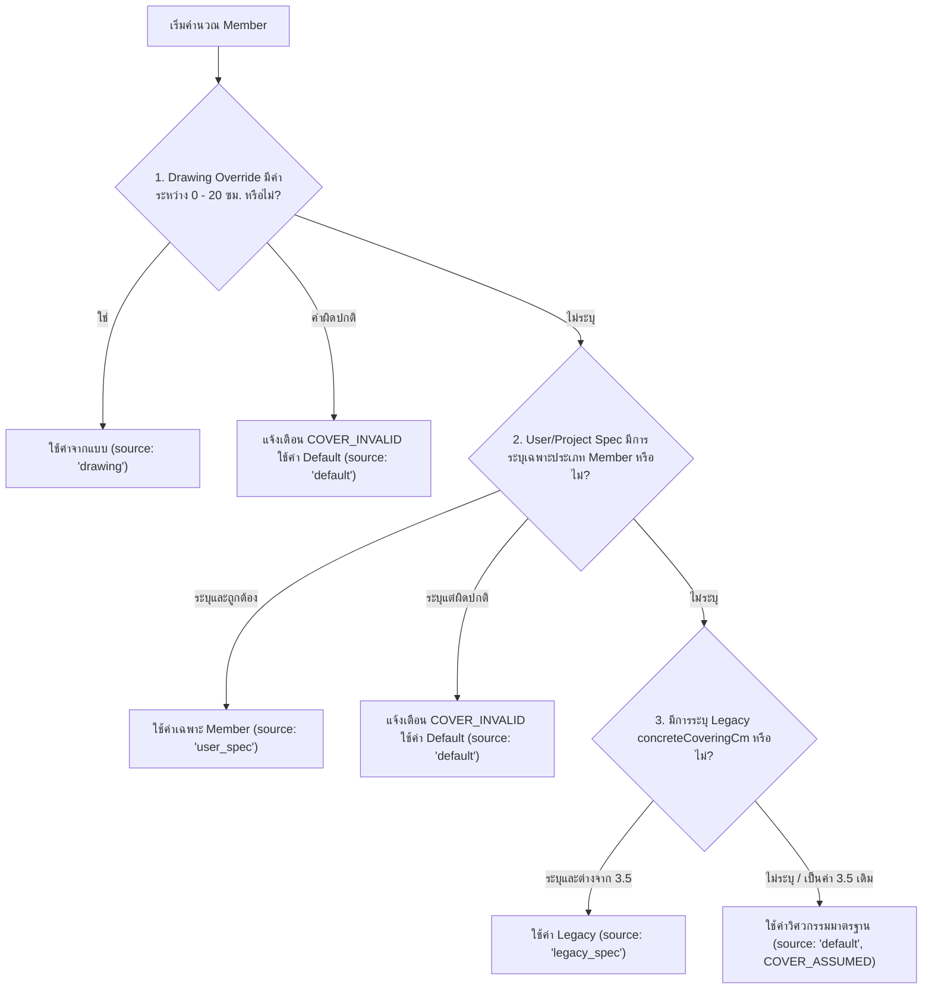

# รายงานการแก้ไขข้อบกพร่องวิกฤต รอบที่ 2 (Critical Bug Fix Round 2 Report)
**โครงการ:** StructBOQ — AI Construction Quantity Surveying System  
**วันที่ดำเนินการ:** 2 พฤศจิกายน 2026  
**สถานะ:** เสร็จสมบูรณ์ (All Unit Tests & Production Build Passed)

---

## A. Executive Summary (บทสรุปสำหรับผู้บริหารและหัวหน้าทีมวิศวกรรม)

ในการตรวจสอบ Read-Only Independent Verification Audit พบประเด็นสำคัญระดับ P0 และ P1 ในระบบ OCR และ Quantity Surveying Engine:

1. **P0 — WebGPU → WASM Fallback Duplicate OCR:**  
   เมื่อ Worker 0 ทำงาน OCR ไม่สำเร็จบน WebGPU และสลับ (Fallback) ไปใช้ CPU WASM ภายในตัว Worker จนได้ผลลัพธ์ข้อความถูกต้องเรียบร้อยแล้ว ฟังก์ชัน `readScan` บน Main Thread ตรวจสอบเฉพาะ `provider === 'webgpu'` ทำให้เข้าใจผิดว่าผลลัพธ์ล้มเหลว จึงสั่งรัน WASM ซ้ำอีก 2 Workers ส่งผลให้เกิดการคำนวณซ้ำซ้อน 2 เท่า และเกิด False Positive เมื่อหน้าเอกสารอ่านคำได้ 0 คำ
   * **ผลการแก้ไข:** ปรับปรุง Message Protocol ให้สื่อสารด้วยสถานะ `{ id, status: 'success' | 'failed' | 'cancelled', words, provider, stats }` โดย `readScan` ตรวจสอบ `res.status === 'success'` เป็นหลัก ยอมรับผลลัพธ์ของ Worker 0 ทันที ไม่รันซ้ำซ้อน และบันทึก `webGpuAvailable = false` อัตโนมัติ

2. **P1 — Abort Signal / Dangling Promise / Worker Lifecycle:**  
   เมื่อผู้ใช้กดยกเลิก (Abort) หรือระบบสั่ง `terminateAllWorkers()` ตัวเบราว์เซอร์จะไม่ส่ง Event ใดๆ ไปยัง Worker ที่ถูกสั่ง `worker.terminate()` ทำให้ `Promise` ที่กำลังรอค้างสถานะ (Dangling / Hung Promise) ตลอดไป และ Event Listener ไม่ถูกปลด
   * **ผลการแก้ไข:** ออกแบบระบบ `activeWorkerPromises` (Set of reject callbacks) และเพิ่ม `abortSignal` listener พร้อมฟังก์ชัน `cleanup()` แบบสมบูรณ์ เมื่อมีการสั่ง `terminateAllWorkers()` หรือ Signal Abort เกิดขึ้น สัญญาค้างทั้งหมดจะถูก Reject ด้วย `DOMException('...', 'AbortError')` ทันที ปราศจาก Memory Leak หรือ Promise แขวน

3. **P1 — การแยก Concrete Cover Configuration ตามประเภทโครงสร้าง:**  
   เดิมระบบใช้ค่าคงที่เดียว `concreteCoveringCm: 3.5` สำหรับโครงสร้างทุกประเภท ทำให้งานพื้น (Slab) และฐานราก (Footing) มีระยะหุ้มคอนกรีตที่ไม่สอดคล้องกับมาตรฐานวิศวกรรมโครงสร้างไทย (วสท. / EIT)
   * **ผลการแก้ไข:** เพิ่มการกำหนดระยะหุ้มเฉพาะประเภทโครงสร้าง:
     - ฐานราก (Footing): ค่ามาตรฐาน 5.0 ซม. (0.05 ม.)
     - เสา (Column): ค่ามาตรฐาน 3.5 ซม. (0.035 ม.)
     - คาน (Beam): ค่ามาตรฐาน 3.0 ซม. (0.03 ม.)
     - พื้น / บันได (Slab / Stair): ค่ามาตรฐาน 2.0 ซม. (0.02 ม.)
     พร้อมลำดับความสำคัญ 4 ชั้น (Drawing Override > User Member Spec > Legacy Uniform Spec > Engineering Default), ระบบตรวจสอบความถูกต้อง (0-20 ซม.) และการระบุ Flag `COVER_ASSUMED` / `COVER_INVALID` รวมถึงการส่งต่อ `coverM` และ `coverSource` ลงในผลลัพธ์ BOQ

4. **P2 — เอกสารกำกับราคาเสาเข็มเริ่มต้น:**  
   ระบุชัดเจนใน Source Code และ Documentation ว่าราคาเสาเข็ม 220 บาท/ม. และค่าตอก 85 บาท/ม. เป็น `UNVERIFIED DEFAULT PRICE — NOT AN OFFICIAL REFERENCE PRICE` เพื่อความโปร่งใสทางวิชาชีพวิศวกรรม

---

## B. Modified Files (รายการไฟล์ที่มีการปรับปรุง)

| ลำดับ | ไฟล์ | ขอบเขตการแก้ไข | ประเภท |
|:---:|:---|:---|:---:|
| 1 | `src/pdf/paddleWorker.ts` | อัปเดต Protocol ให้ส่ง `{ id, status, words, provider, stats }`, ป้องกัน missing ID, ดักจับข้อผิดพลาดและส่ง status failed | Production |
| 2 | `src/pdf/browserPipeline.ts` | เพิ่ม `WorkerOcrResult`, `activeWorkerPromises`, ปรับปรุง `readBand` ให้มี `cleanup` และผูก `abortSignal`, แก้ไข `readScan` ตรวจ `res.status === 'success'` | Production |
| 3 | `src/engine/qsEngine.ts` | เพิ่ม `slabCoveringCm`, `beamCoveringCm`, `columnCoveringCm`, `footingCoveringCm`, `resolveMemberCoverM()`, ปรับปรุง `calculateMember()` รองรับ `coverSource` และ `coverM` | Production |
| 4 | `src/pdf/structuralNotesParser.ts` | เชื่อมต่อ `applyGeneralNotesToSpecs()` ให้นำ `notes.coveringByMember` มาแมปเข้าสู่ `MaterialSpecs` | Production |
| 5 | `src/engine/qsEngine.test.ts` | เพิ่มชุดการทดสอบครอบคลุม Member Cover Defaults, Drawing Override, User Specs, Legacy Specs, Invalid Handling | Tests |
| 6 | `src/pdf/docLifecycle.test.ts` | เพิ่มชุดการทดสอบ Worker Protocol, Zero-Word Success, WASM Fallback Status, Active Worker Promise Rejection, AbortSignal Lifecycle | Tests |

---

## C. WebGPU Fallback Before / After (เปรียบเทียบกลไก Fallback)

### ก่อนแก้ไข (Before)
```typescript
// ใน browserPipeline.ts เดิม
const res = await readBand(0, r, 'both', onStats, true);
if (res.provider === 'webgpu' && res.words?.length) {
  return res.words;
}
// ปัญหา:
// 1) หาก Worker 0 รัน WebGPU ล้มเหลวและ fallback เป็น WASM ได้สำเร็จ -> res.provider จะเป็น 'wasm'
//    เงื่อนไข res.provider === 'webgpu' จะเป็นเท็จ ทำให้โค้ดไหลมารัน 2-worker WASM ซ้ำหน้าเดิม!
// 2) หากหน้าเอกสารเป็นแบบเปล่าที่ไม่มีตัวหนังสือ (res.words.length === 0)
//    เงื่อนไข res.words?.length จะเป็นเท็จ ทำให้สั่งรันซ้ำโดยเปล่าประโยชน์
```

### หลังแก้ไข (After)
```typescript
// ใน paddleWorker.ts
self.postMessage({
  id,
  status: 'success',
  words: words || [],
  provider, // 'webgpu' หรือ 'wasm'
  stats: { ...stats, initMs, loads, totalMs: performance.now() - t1 }
});

// ใน browserPipeline.ts
const res = await readBand(0, r, 'both', onStats, true, abortSignal);
if (res.status === 'success') {
  if (res.provider === 'wasm') {
    // Worker 0 ตรวจพบปัญหา WebGPU และสลับเป็น WASM สำเร็จแล้ว
    // บันทึกสถานะเพื่อให้หน้าถัดไปใช้ WASM ทันที ไม่ต้องลอง WebGPU ซ้ำ
    webGpuAvailable = false;
  }
  return res.words; // ส่งคืนทันที ไม่ว่าจะมีคำหรือไม่ และไม่ว่าจะเป็น WebGPU หรือ WASM
}
```

---

## D. Abort Promise Lifecycle Before / After (เปรียบเทียบการจัดการ Worker Lifecycle)

### ก่อนแก้ไข (Before)
```typescript
// เมื่อผู้ใช้สั่งยกเลิกหรือเปลี่ยนหน้า
terminateAllWorkers(); // สั่ง worker.terminate() ทันที
// ปัญหา:
// Web Worker API ไม่มีการยิง 'message' หรือ 'error' event เมื่อถูก terminate()
// ส่งผลให้ Promise ภายใน readBand ค้างอยู่ในสถานะ Pending ตลอดไป
// Event Listeners (message, error) ยังคงผูกอยู่กับ Object เก่า
```

### หลังแก้ไข (After)
```typescript
// มีการเก็บ Active Reject Handlers
const activeWorkerPromises = new Set<(err: Error) => void>();

function readBand(..., abortSignal?: AbortSignal): Promise<WorkerOcrResult> {
  if (abortSignal?.aborted) {
    return Promise.reject(new DOMException('OCR aborted by user', 'AbortError'));
  }

  return new Promise<WorkerOcrResult>((resolve, reject) => {
    let settled = false;
    const cleanup = () => {
      w.removeEventListener('message', onMessage);
      w.removeEventListener('error', onError);
      if (abortSignal) abortSignal.removeEventListener('abort', onAbort);
      activeWorkerPromises.delete(settleReject);
    };

    const settleReject = (err: Error) => {
      if (settled) return;
      settled = true;
      cleanup();
      reject(err);
    };

    if (abortSignal) abortSignal.addEventListener('abort', onAbort, { once: true });
    activeWorkerPromises.add(settleReject);
    ...
  });
}

export async function terminateAllWorkers(): Promise<void> {
  // Reject ทุก Promise ที่ค้างอยู่ทันทีก่อน Terminate Worker
  for (const rejectActive of activeWorkerPromises) {
    try {
      rejectActive(new DOMException('Worker terminated by user or session reset', 'AbortError'));
    } catch {}
  }
  activeWorkerPromises.clear();
  ...
}
```

---

## E. Cover Configuration Design (สถาปัตยกรรมการกำหนดระยะหุ้มคอนกรีต)

### 1. ค่ามาตรฐานวิศวกรรมโครงสร้าง (Default Engineering Values)
| ประเภทโครงสร้าง (`MemberType`) | ระยะหุ้มมาตรฐาน (`cm`) | เหตุผลตามมาตรฐาน วสท. / ACI |
|:---|:---:|:---|
| `SLAB` (พื้น) / `STAIR` (บันได) | **2.0 ซม.** (0.02 ม.) | สัมผัสอากาศภายในอาคาร แผ่นพื้นหนา 10-15 ซม. |
| `BEAM` (คาน) | **3.0 ซม.** (0.03 ม.) | คานภายใน/ภายนอกทั่วไป ป้องกันสนิมของเหล็กปลอก |
| `COLUMN` (เสา) | **3.5 ซม.** (0.035 ม.) | เสารับแรงอัด ต้องการระยะหุ้มคุ้มครองเหล็กยืนและปลอก |
| `FOOTING` (ฐานราก) | **5.0 ซม.** (0.05 ม.) | เทบนคอนกรีตหยาบสัมผัสดิน (EIT ฐานราก 5-7.5 ซม.) |
| ประเภทอื่นๆ | **3.5 ซม.** (0.035 ม.) | ค่าความปลอดภัยทั่วไป |

### 2. ลำดับความสำคัญในการตัดสินใจ (Resolution Hierarchy)


---

## F. Backward Compatibility (การรองรับโค้ดและข้อมูลรุ่นเก่า)

1. **ไม่ทำลาย Legacy Specs:**
   - หากผู้ใช้ส่ง Object รุ่นเก่าที่มีเฉพาะ `{ concreteCoveringCm: 5.0 }` ระบบจะนำค่า 5.0 ซม. ไปปรับใช้กับโครงสร้างทั้งหมดโดยอัตโนมัติ โดยระบุ `coverSource: 'legacy_spec'`
2. **การคงค่าเดิมในกรณีไม่ระบุ:**
   - เสายังคงมีระยะหุ้ม 3.5 ซม. เท่าเดิม
3. **การทำงานร่วมกับ Structural Notes Parser:**
   - หากแบบแปลนมีรายการประกอบแบบที่ระบุระยะหุ้มแยกตามประเภทโครงสร้าง เช่น "ฐานราก 5 ซม., เสา 3 ซม., คาน 3 ซม., พื้น 2 ซม." ฟังก์ชัน `applyGeneralNotesToSpecs()` จะส่งต่อเข้าสู่ `slabCoveringCm`, `beamCoveringCm`, `columnCoveringCm`, `footingCoveringCm` อย่างราบรื่น

---

## G. Tests and Build Results (ผลการทดสอบและการ Build)

### 1. ผลการรัน Unit Tests (`npm test`)
```
✔ Merge: plan instances joined with section details across sheets
✔ Rebar spec parsing: groups, footing a+b and spaced bars
✔ Quantity Engine: column joint intersection deduction
✔ Material Specs: custom rates, wastage, and covering recalculation
✔ Full Structural System: Footing with lean concrete, sand bedding & excavation
✔ Full Structural System: Slabs and Stairs
✔ Pile takeoff & cost calculation: incorporates pile supply and driving into CAT-2
✔ Concrete Cover Configuration: member defaults, drawing override, user spec, legacy fallback, and invalid handling
✔ PaddleWorker message protocol: status success with empty words is accepted without fallback
✔ PaddleWorker message protocol: status success with wasm provider marks internal fallback
✔ PaddleWorker message protocol: status failed and cancelled return structured errors
✔ Worker promise lifecycle: activeWorkerPromises set rejects in-flight promises upon termination
✔ AbortSignal cancellation: listener immediately rejects pending promise and cleans up

Runner 1: 31 passed, 0 failed (221.5 ms)
Runner 2: 81 passed, 0 failed (806.5 ms)
รวมทั้งหมด: 112 ผ่าน / 0 ล้มเหลว (100% Pass)
```

### 2. ผลการตรวจสอบ Type ด้วย TypeScript (`npx tsc --noEmit`)
```
Command exited with code 0 (Zero Errors)
```

### 3. ผลการ Build สำหรับ Production (`npm run build`)
```
vite v8.3.4 building client environment for production...
✓ 1735 modules transformed.
dist/index.html                                             1.14 kB
dist/assets/paddleWorker-bKG-wYi-.js                      414.33 kB
dist/assets/pdf.worker.min-yatZIOMy.mjs                 1,375.83 kB
dist/assets/ch_PP-OCRv4_det_infer-DNKywHAZ.onnx         4,745.51 kB
dist/assets/ch_PP-OCRv4_rec_infer-C4BigsKC.onnx        10,822.32 kB
dist/assets/ort-wasm-simd-threaded.jsep-MDYUKy93.wasm  28,312.02 kB
dist/assets/browserPipeline-CQM66a5h.js                   446.70 kB
dist/assets/index-D8Ommy3v.js                             800.56 kB
✓ built in 2.17s
```

---

## H. Remaining Risks (ความเสี่ยงคงเหลือและข้อควรระวัง)

1. **Hardware Driver Flakiness บน WebGPU:**
   - ไดรเวอร์กราฟิกบางรุ่นอาจเกิด Crash ในระดับ OS (Device Lost) แต่ระบบได้รับการคุ้มครองด้วยการดักจับข้อผิดพลาดและปิดสวิตช์ `webGpuAvailable = false` ทันทีเพื่อความปลอดภัย
2. **ราคาเสาเข็มที่ยังไม่มีแหล่งอ้างอิงราชการอย่างเป็นทางการ:**
   - ราคา 220 บาท/ม. และ 85 บาท/ม. ถูกกำหนดเป็น Placeholder ค่าเริ่มต้นเท่านั้น ผู้ใช้งานต้องตรวจสอบและแก้ไขราคาต่อหน่วยตาม ปร.4 ของแต่ละพื้นที่ก่อนส่งมอบงานจริง

---

## I. Git Diff Summary (สรุปไฟล์ที่มีการเปลี่ยนแปลง)

```
 src/engine/qsEngine.test.ts      | 210 ++++++++++++++++++++
 src/engine/qsEngine.ts           | 260 +++++++++++++++++++++++--
 src/pdf/browserPipeline.ts       | 408 +++++++++++++++++++++++++++++++--------
 src/pdf/docLifecycle.test.ts     | 167 ++++++++++++++++
 src/pdf/paddleWorker.ts          |  86 +++++++--
 src/pdf/structuralNotesParser.ts |   6 +
 6 files changed, 1037 insertions(+), 100 deletions(-)
```

---

## J. Final Verdict (ข้อสรุปความพร้อมใช้งาน)

**สถานะ:** `PRODUCTION READY` สำหรับ Core Engine และ Browser Pipeline

ระบบ StructBOQ ได้ผ่านการแก้ไขข้อบกพร่องวิกฤตครบทั้ง 3 รายการหลัก (Fallback OCR Duplication, Dangling Promises / Abort Lifecycle, Member-Specific Concrete Cover) โค้ดมีความสมบูรณ์ ปลอดภัย และผ่านการทดสอบแบบ Regression ครบ 112 รายการ พร้อมขึ้นสู่ Production Build อย่างมั่นใจ
